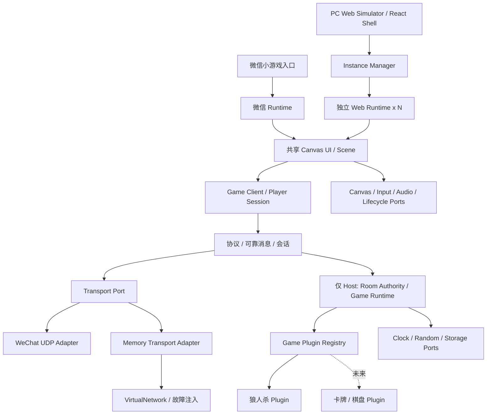
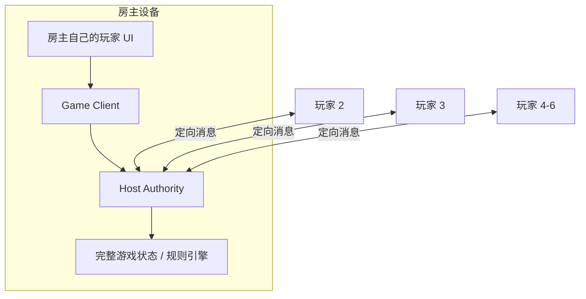
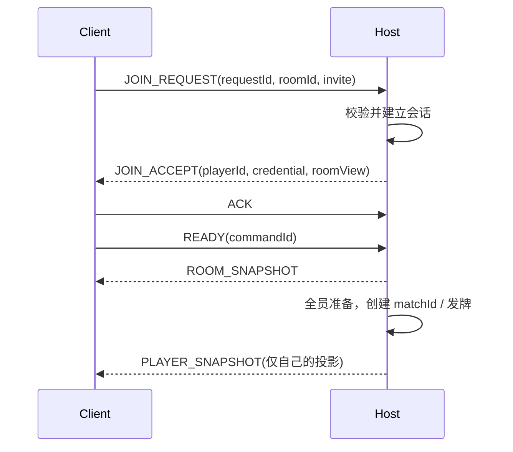
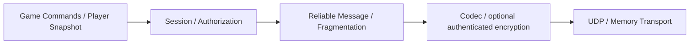
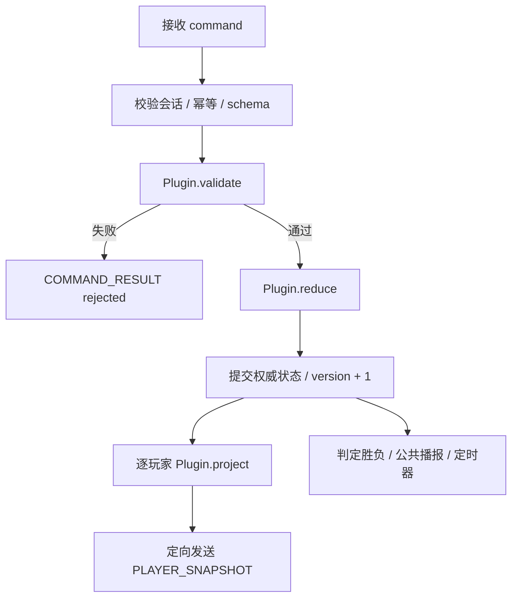
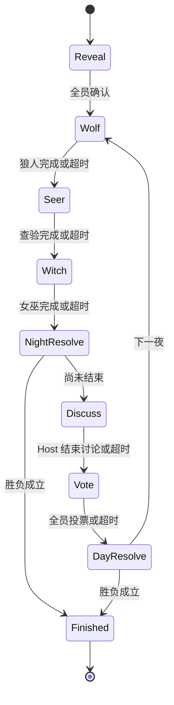
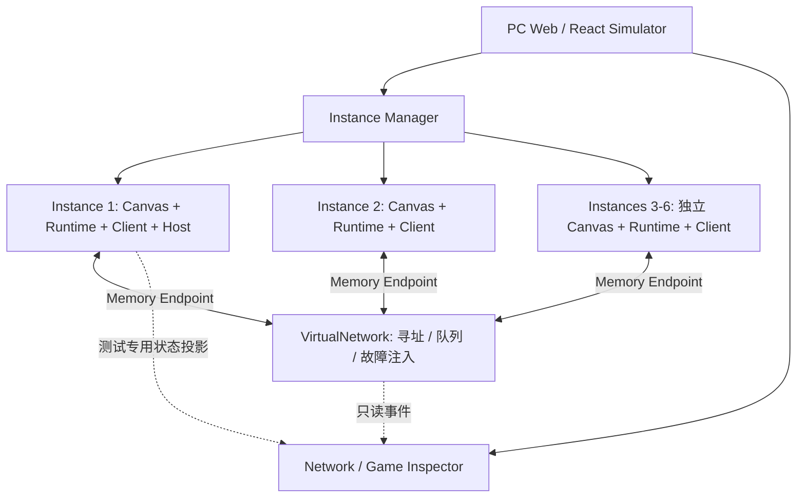
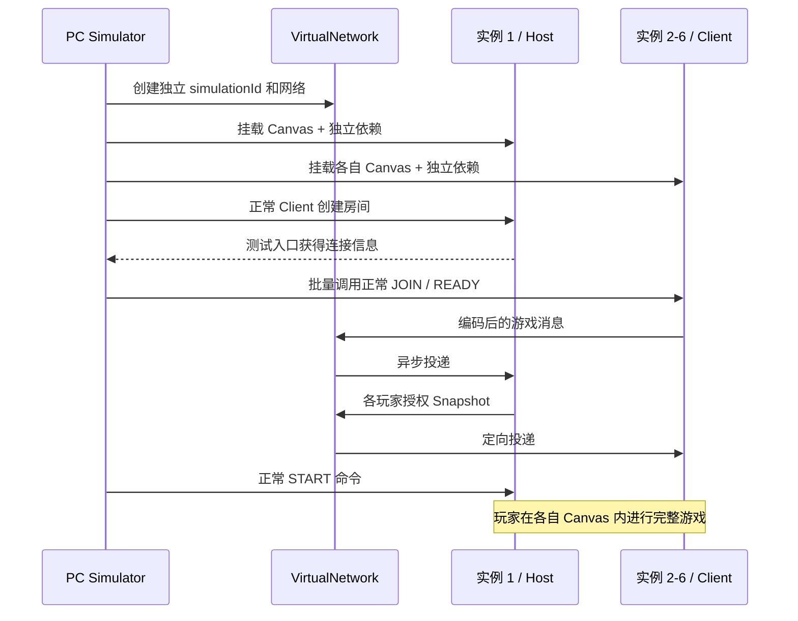

# 本地多人小游戏框架与狼人杀原型设计方案

> 版本：v0.2 · 日期：2026-11-25 · 状态：原型设计 / 待技术验证  
> 目标平台：微信小游戏、PC Web（单页面多实例开发与模拟测试）  
> 核心约束：TypeScript、纯代码开发、无独立业务服务器、面向线下多人游戏。

## 版本变更

- v0.2：PC Web 单页面直接挂载 N 个独立小游戏实例；以 VirtualNetwork + Memory Transport 替代原先的 iframe/BroadcastChannel 模拟方案，并同步调整平台接口、项目结构、测试及验收。微信 LAN UDP、无业务服务器、狼人杀范围保持不变。
- v0.1：初始完整技术设计。

## 目录

- [1. 项目背景与目标](#1-项目背景与目标)
- [2. 原型产品需求](#2-原型产品需求)
- [3. 技术可行性与关键决策](#3-技术可行性与关键决策)
- [4. 总体架构](#4-总体架构)
- [5. 项目结构与技术栈](#5-项目结构与技术栈)
- [6. 平台适配与轻量渲染框架](#6-平台适配与轻量渲染框架)
- [7. 多人房间与会话](#7-多人房间与会话)
- [8. Transport 与网络协议](#8-transport-与网络协议)
- [9. 通信可靠性、安全与恢复](#9-通信可靠性安全与恢复)
- [10. 通用游戏运行时与插件](#10-通用游戏运行时与插件)
- [11. 狼人杀规则引擎](#11-狼人杀规则引擎)
- [12. 游戏界面与交互](#12-游戏界面与交互)
- [13. Web 模拟联机工作台](#13-web-模拟联机工作台)
- [14. 测试与验收](#14-测试与验收)
- [15. 开发计划与交付物](#15-开发计划与交付物)
- [16. 后续演进与风险](#16-后续演进与风险)
- [17. 实施约束与参考资料](#17-实施约束与参考资料)

## 1. 项目背景与目标

开发一款面向朋友聚会、聚餐、团建等场景的本地多人小游戏。玩家在同一物理空间面对面交流，每人使用自己的手机参与游戏。游戏负责随机发牌、裁判播报、操作收集、规则校验、状态同步及胜负结算，不承担远程交流和陌生人社交。

长期定位不是单独的狼人杀助手，而是一个可逐步扩展不同线下游戏的轻量 2D 多人游戏框架。狼人杀作为首款游戏验证基础设施。

### 1.1 成功标准

1. 微信小游戏在同一局域网中实现一台房主设备与多个客户端的真实联机，无需部署业务服务。
2. 六名玩家可以通过各自设备完整完成一局狼人杀，无须额外安排真人裁判。
3. 每位玩家只收到自己的可见游戏状态；不通过隐藏 UI 的方式保护完整身份数据。
4. PC Web 使用同一套游戏逻辑与玩家 Canvas UI，在单一页面内动态挂载六个独立小游戏实例（每实例独立 Canvas、Runtime、Client 与会话），支持自动化测试与故障注入，无须打开多个 Tab 或 iframe。
5. 第二款回合制游戏可以通过注册游戏模块扩展，不需要修改多人通信、房间或微信适配层。

其中第 1 项是待验证的技术假设，不是已经实现的能力；第 5 项在本期只验证接口设计与小型测试插件，不开发完整第二款游戏。

### 1.2 范围边界

| 本期实现 | 本期不做 |
|---|---|
| 微信小游戏真实 LAN 联机 | 抖音、小程序、原生 App、远程 Web 联机 |
| PC Web 单页面多 Canvas 实例模拟 | 云端中继、业务后端、数据库 |
| 固定六人狼人杀规则 | 多板子编辑器、商城、排行榜、匹配 |
| 房间、座位、准备、发牌、裁判、投票 | 微信登录、独立账号、社交关系、聊天/语音通话 |
| 基础可靠消息和断线重连 | Host 自动迁移、进程被杀后的完整恢复 |
| 共享 Canvas 2D UI、基础音效 | 完整通用游戏引擎、ECS、物理、WebGL/3D |
| 测试环境调试工具 | 正式发布、商业化、生产级反作弊 |

无业务服务器不等同于绝对离线：微信启动、体验版分发和代码包加载可能仍依赖平台及互联网。Web 的 Vite 静态资源服务不参与房间与游戏通信。

## 2. 原型产品需求

### 2.1 角色与使用场景

- 房主：建立房间、查看邀请码、开始游戏、主持公共播报、处理暂停与退出。房主也是六名玩家之一，不额外占用裁判席位。
- 普通玩家：加入房间、确认座位与准备状态、查看自己的身份、提交技能及投票。
- 虚拟裁判：运行在房主设备中的确定性规则引擎，不需要 LLM。
- Web 调试者：通过 PC Web Simulator 在同一页面创建、操作多个独立小游戏实例，查看测试用完整状态、模拟异常网络。

### 2.2 功能优先级

| ID | 需求 | 优先级 | 验收 |
|---|---|---|---|
| F01 | 游戏入口、创建/加入房间 | P0 | 两端进入同一房间，显示一致成员名单 |
| F02 | 六个座位、昵称、准备 | P0 | 重复昵称可区分，座位不重复，全部准备才可开始 |
| F03 | 随机发牌、身份确认 | P0 | 数量符合板子，玩家仅见授权信息 |
| F04 | 夜间技能 | P0 | 狼人、预言家、女巫按固定顺序行动 |
| F05 | 白天讨论、投票、结算 | P0 | 自动汇总票数与判断胜负 |
| F06 | 裁判提示与播报 | P0 | 公共语音不泄露私密行动，可关闭音频 |
| F07 | 断线重连 | P0 | 游戏在 Host 仍存活时恢复玩家视图，不重复分配座位 |
| F08 | Web 模拟器与事件检查器 | P0 | 单个 PC 页面动态生成六个独立小游戏实例并完成一局 |
| F09 | LAN 二维码加入 | P1 | P0 验证扫码能力后开发，保留手工输入 |
| F10 | 游戏重开及房间复用 | P0 | 新 matchId，清空上一局身份/命令 |
| F11 | 网络自动发现、广播 | P2 | 不阻塞本期 |
| F12 | Host 持久化恢复、迁移 | P2 | 不阻塞本期 |

## 3. 技术可行性与关键决策

### 3.1 为什么采用微信小游戏

普通小程序更适合表单和工具类应用；本项目预计逐步支持卡牌、棋盘及聚会互动游戏，因此采用微信小游戏，Web 与小游戏共用 Canvas 2D UI 和游戏代码，避免将 UI 绑定于微信小程序组件或浏览器 DOM。

本期不引入 Unity、Godot、PixiJS 或重型渲染引擎。先实现必要的 Canvas UI 基元，在第二款游戏确实需要时再评估成熟渲染库。这个决策不是对相关库的平台兼容性作全面结论。

### 3.2 平台网络能力证据

微信官方维护的 `minigame-api-typings` 类型定义中包含以下 API：[R1][R2]。

| 能力 | 微信小游戏 | Web 模拟器 | 决策 |
|---|---|---|---|
| UDP Socket 创建 | `wx.createUDPSocket`（基础库 2.7.0 起） | 浏览器没有通用 UDP Socket API | 微信 UDP adapter |
| 绑定端口、收发 | `bind/send/onMessage/close` | 不适用 | 真机测试作为 Gate 0 |
| 获取局域网 IP | `wx.getLocalIPAddress`（2.20.1 起） | 不依赖真实 IP | 手输 IP 兜底 |
| 扫码 | `wx.scanCode`（2.16.1 起） | 非必须 | P1 可选 |
| UDP 广播 | `send.setBroadcast`（2.24.0 起） | 不适用 | 不作为 P0 依赖 |
| Web 单页面进程内通信 | 不适用 | 独立 Memory Transport endpoint + VirtualNetwork | 不需要跨窗口 API 或业务服务 |
| 密码学安全随机数 | `wx.getUserCryptoManager().getRandomValues` | `crypto.getRandomValues` | 平台适配，验证离线可用性 |

类型定义中 UDP 接收消息长度标注为小于 4096 字节。本方案选用更保守的 1200 字节应用层数据报预算，超出时分片（不是微信官方规定的 MTU）。

建议 PoC 选择基础库不低于 2.20.1，并以当前开发者工具和目标真机实际可用版本为准；如启用广播再单独验证 2.24.0 及以上。运行时仍需功能检测。

**尚未确认：** iOS/Android 真机双向 UDP、指定/随机端口绑定、热点兼容性、局域网授权、切后台后 Socket 恢复，以及随机数 API 在体验版和断网下的行为。公开类型信息不能证明这些真实场景可用。

### 3.3 架构决策记录（ADR）

| ADR | 决策 | 原因 |
|---|---|---|
| 001 | 微信小游戏 + Web，暂不支持抖音 | 聚焦无业务服务器可行性 |
| 002 | Authoritative Host-Client，而非全互联 P2P | 简化一致性、隐藏信息和规则判定 |
| 003 | PC Web 单页面多 Canvas 实例 + VirtualNetwork/Memory Transport | 无 iframe、多窗口或中继；共享游戏代码、多实例独立状态 |
| 004 | 共享 Canvas 2D UI、平台适配层 | 保持双端渲染代码一致 |
| 005 | 函数式 Game Plugin + Reducer | 游戏规则独立、可重放、可测试 |
| 006 | Command + 按玩家投影的完整 Snapshot | 状态小、交互低频，优先保证正确性 |
| 007 | 无独立账号，临时会话 | 降低原型成本 |
| 008 | 不做自动 Host 迁移 | 避免全量秘密复制和复杂一致性 |
| 009 | 可信隔离 LAN 内测，可明文 PoC；开放测试前引入认证加密 | 原型先验证连接，明确安全边界 |

## 4. 总体架构



### 4.1 Host-Client 拓扑



Host 自己的玩家操作也必须经同样的命令验证、状态投影流程，使用本地 loopback，不允许 UI 直接修改权威状态。普通玩家无须相互通信。

### 4.2 模块边界

- `framework`：Canvas UI、场景、输入、渲染、布局、资源、音频等游戏表现层能力。
- `multiplayer`：房间、身份、连接、协议、可靠消息、Host 运行时及 Client 状态。
- `game-contract`：游戏定义和命令、投影、生命周期接口。
- `games/werewolf`：狼人杀状态、规则、配置、专属 UI 和资源。
- `platform`：Web/WeChat 适配，禁止平台全局对象泄漏到核心代码。
- `testing`：VirtualNetwork、Memory Transport、虚拟时钟、确定性随机数及测试夹具；与 PC Web 工作台共享。
- `apps/web/simulator`：PC 控制台、实例管理、Canvas 挂载及 Inspector；不参与权威规则计算。

依赖方向：入口 → UI / 应用 → 核心契约；游戏规则依赖契约，不依赖 UI、网络或平台。Host 与 Client 可以在同一进程运行但职责分离。

## 5. 项目结构与技术栈

```text
local-multiplayer-games/
├── apps/
│   ├── web/                  # Vite + React PC 工作台
│   │   ├── src/player/       # 实例挂载入口（无全局 Runtime）
│   │   ├── src/simulator/
│   │   │   ├── instance-manager/
│   │   │   ├── components/   # PlayerTile / Toolbar / Inspector
│   │   │   └── scenarios/    # 测试场景与批量操作
│   │   └── vite.config.ts
│   └── wechat/
│       ├── src/main.ts
│       ├── game.json
│       └── project.config.json
├── packages/
│   ├── game-contract/
│   ├── framework/
│   │   ├── runtime/  scene/  renderer/  ui/  layout/
│   │   └── input/  assets/  audio/
│   ├── multiplayer/
│   │   ├── room/  session/  protocol/  transport/
│   │   ├── reliable/  host/  client/
│   │   └── tests/
│   ├── platform/
│   │   ├── types/  web/  wechat/
│   │   └── tests/
│   ├── games/
│   │   └── werewolf/
│   │       ├── rules/  roles/  phases/  presets/
│   │       ├── scenes/  components/  assets/  tests/
│   └── testing/
│       ├── memory-transport/
│       ├── virtual-network/
│       ├── network-simulator/
│       └── fixtures/
├── scripts/build-wechat.ts
├── docs/
├── package.json
├── pnpm-workspace.yaml
├── tsconfig.base.json
└── AGENTS.md
```

以上是逻辑目录，不要求每个子目录成为独立 npm 包。初期可合并 game-contract 与 multiplayer，等第二款游戏出现后再调整包边界。

| 项目 | 选型 |
|---|---|
| 语言与组织 | TypeScript strict、函数式工厂、pnpm workspace |
| Web | Vite + React PC 工作台；每个玩家 Tile 内直接挂载共享 Canvas 游戏实例，不使用 iframe |
| 微信 | 原生小游戏 API + esbuild 单独构建；minigame-api-typings |
| 游戏 UI | 共享 Canvas 2D、轻量节点树与声明式 UI |
| 状态 | 纯函数 reducer + 小型 subscribe/getState store |
| 消息 | JSON + UTF-8、运行时 schema 校验（可用 Zod，评估包大小） |
| 测试 | Vitest、Memory Transport、浏览器 Simulator、微信真机 |
| 资源 | 本地打包图片/音频；不依赖业务 CDN |

微信构建不得依赖 DOM、Node.js built-ins、动态远程 JS 或未验证的浏览器 API。编码、随机数和计时能力由 adapter 实现。Web 和 WeChat 分别使用对应 tsconfig；共享核心不引入 DOM/微信环境类型。

建议命令（待工程落地，不表示已有实现）：

```bash
pnpm install
pnpm dev:web
pnpm test
pnpm typecheck
pnpm build:web
pnpm build:wechat
```

微信开发者工具导入 `dist/wechat`，输出至少包含 `game.js`、`game.json` 及必要静态资源、项目配置；使用自己的测试 AppID，配置不提交真实密钥。

## 6. 平台适配与轻量渲染框架

### 6.1 Platform Ports

以下 TypeScript 为接口草案，并非已经编译的源码。Canvas、音频、时间等细节按 PoC 调整。

```ts
interface Unsubscribe { (): void }
interface Point { x: number; y: number }
interface Viewport {
  width: number; height: number; pixelRatio: number;
  safeArea: { top: number; right: number; bottom: number; left: number };
}
interface Clock {
  now(): number; // 单调时间，供 Host 计时
  setTimeout(fn: () => void, ms: number): Unsubscribe;
}
interface RandomSource {
  bytes(length: number): Promise<Uint8Array>;
}
interface StoragePort {
  get(key: string): Promise<string | null>;
  set(key: string, value: string): Promise<void>;
  remove(key: string): Promise<void>;
}
interface Platform {
  viewport(): Viewport;
  createCanvas(): CanvasPort;
  requestFrame(fn: (time: number) => void): Unsubscribe;
  onPointer(fn: (event: PointerInput) => void): Unsubscribe;
  onResize(fn: (view: Viewport) => void): Unsubscribe;
  onVisibility(fn: (visible: boolean) => void): Unsubscribe;
  promptText(options: TextInputOptions): Promise<string | null>;
  audio: AudioPort;
  storage: StoragePort;
  clock: Clock;
  random: RandomSource;
}
```

`CanvasPort`、`PointerInput`、`AudioPort` 等由 framework 定义窄接口，避免引用 `HTMLCanvasElement` 等浏览器专有类型。

| Port | Web | 微信小游戏 |
|---|---|---|
| Canvas | 每实例注入独立 HTML Canvas | wx.createCanvas 等平台 API |
| Pointer | 每个 Canvas 独立 Pointer Events，按自身坐标映射 | wx.onTouchStart/Move/End/Cancel |
| 文本输入 | 每实例独立 DOM overlay，焦点与归属显式管理 | wx.showKeyboard 等能力，真机验证 |
| 帧调度 | 页面级 requestAnimationFrame 调度器，独立实例回调 | 小游戏对应运行时帧调度 |
| 音频 | HTMLAudio/Web Audio | wx.createInnerAudioContext |
| 生命周期 | 实例级模拟 show/hide；页面级 visibilitychange/pagehide 由管理器处理 | wx.onShow/onHide |
| 保持唤醒 | 可选屏幕唤醒能力 | wx.setKeepScreenOn（能力检测） |
| 本地存储 | 每实例独立 Memory Storage；按需使用命名空间持久化 | wx Storage API |

微信用户拒绝权限、API 不存在或调用失败时显示具体错误，不静默改用云服务。

### 6.2 UI 与渲染

采用节点树 + 简单声明式函数，不必实现 JSX 编译器、完整 React reconciler 或 Hooks 系统。可先使用工厂函数：

```ts
const RoomScene = (vm: RoomViewModel) => column({ gap: 16 }, [
  text('狼人杀房间', { size: 24 }),
  text(vm.roomCode),
  playerList(vm.players),
  button('开始游戏', { disabled: !vm.canStart, onPress: vm.start }),
]);
```

P0 组件：View、Row、Column、Text、Button、Card、List、Modal、Toast、数字输入/平台键盘桥接。Scene 生命周期支持 enter、update、render、exit；所有监听在退出时释放。布局支持 padding/gap、固定尺寸、简单 flex、居中、安全区域，优先竖屏。

渲染建议使用逻辑坐标，按 DPR 设置画布像素尺寸，触摸坐标反向转换。场景变化触发重绘，动画期间才持续调度帧；输入命中按可见层级逆序，弹窗拦截底层点击。第一期不需要完整 ECS、复杂场景编辑器、完整 CSS 或物理系统。

资源通过 AssetManifest 管理，预加载失败可重试。音频仅 Host 播放公共播报；其他设备默认静音，避免重复和延迟造成回声。私密提示使用屏幕文字，不通过扬声器泄露身份。

## 7. 多人房间与会话

### 7.1 数据模型

```ts
type RoomStatus = 'lobby' | 'playing' | 'finished' | 'closed';
interface RoomPlayer {
  playerId: string; nickname: string; seat: number;
  ready: boolean; connected: boolean; isHost: boolean;
}
interface RoomState {
  roomId: string; hostId: string; gameId: string;
  rulesVersion: string; roomVersion: number;
  matchId: string | null; status: RoomStatus;
  players: readonly RoomPlayer[];
}
```

私密的 session credential、地址、序列号及重连信息由 SessionStore 保存，不进入 RoomView。玩家名称限制长度、去除控制字符；playerId 与昵称独立。新房间、对局、消息、会话使用足够随机的 ID。

### 7.2 创建与加入流程

1. Host 创建 UDP socket，成功绑定端口后读取 IP，生成 roomId 和临时入房凭证。
2. 展示 IP:port 与邀请码；优先手输，P1 再支持离线生成二维码与 `wx.scanCode`。
3. Client 启动 socket，向 Host 的物理地址发出 JOIN。Host 校验协议、房间状态、凭证和容量。
4. Host 根据 `remoteInfo` 记录实际来源端点，而非盲信请求中自报的 IP；签发独立 playerId 和会话凭证，分配空闲座位。
5. Client 确认入房并获得房间快照；所有客户端更新座位状态。
6. 全员准备且连接正常后，Host 允许开始；游戏中不接受新成员，只接受原玩家重连。

连接码不是任意六位数字。P0 可直接显示 `192.168.1.10:20000`（示例）和单独的邀请码；二维码内容可用 `lan-game:v1:<base64url JSON>`，包含协议版本、IP、端口、roomId、临时邀请码。扫码解析只接受本地协议和合法端口，禁止自动访问任意 URL。仅 Web 模式下使用 networkId/nodeId 逻辑 endpoint 与 roomId，不要求伪造 IP。

### 7.3 会话与退出

每位玩家每局只有一个活动会话。重复 JOIN 使用同一个 requestId 进行幂等处理。原玩家重连必须校验独立恢复凭证并重新绑定当前地址；座位不能仅凭 nickname 或 playerId 被抢占。大厅允许离开及重新加入；游戏中离开视为断线，等待重连或 Host 结束对局。Host 主动退出时关闭房间，P0 不选举新 Host。



## 8. Transport 与网络协议

### 8.1 物理地址与 Transport Port

初次 JOIN 尚没有逻辑 peerId，因此必须显式建模物理地址，不能只提供 `send(peerId)`。Network 层在会话成功后建立逻辑玩家和物理 endpoint 的映射。

```ts
type Endpoint =
  | { kind: 'udp'; host: string; port: number }
  | { kind: 'memory'; networkId: string; nodeId: string };
interface Packet {
  from: Endpoint; payload: Uint8Array;
}
interface Transport {
  start(): Promise<Endpoint>;
  stop(): Promise<void>;
  send(to: Endpoint, bytes: Uint8Array): Promise<void>;
  onPacket(handler: (packet: Packet) => void): Unsubscribe;
  onError(handler: (error: Error) => void): Unsubscribe;
}
```

`send` 成功只表示交给平台发送，不表示对端收到。微信适配器保留 ArrayBuffer 的准确 byteOffset/length，不误发整个底层 buffer。每设备一个活动 socket；离开房间时取消订阅并 close。Host 和本机 Client 使用本地 loopback；Web 每个模拟设备拥有自己的 Memory Transport endpoint。

### 8.2 网络分层



### 8.3 统一消息模型

```ts
interface Envelope<T> {
  v: 1;
  roomId: string;
  matchId: string | null;
  from: string;
  to: string;
  sessionEpoch: string;
  messageId: string;
  type: string;
  payload: T;
}
interface GameCommand<C> {
  commandId: string;
  phaseId: string;
  expectedVersion: number;
  action: C;
}
interface PlayerSnapshot<V> {
  version: number;
  phaseId: string;
  view: V;
}
```

实际落地用 discriminated union 和 schema 定义所有合法 payload；未认证 JOIN 使用单独的握手消息 schema。身份从会话绑定解析，绝不从 action 自报 actorId 取得授权。命令请求含 `commandId`，重发时保持同一 ID。

| 消息 | 方向 | 说明 |
|---|---|---|
| JOIN_REQUEST / JOIN_ACCEPT / JOIN_REJECT | C→H / H→C | 建立房间会话，拒绝提供错误码 |
| RESUME_REQUEST / RESUME_ACCEPT | C→H / H→C | 重新绑定端点、同步快照 |
| ROOM_COMMAND / ROOM_SNAPSHOT | C→H / H→C | 准备、开始、离开及房间状态 |
| GAME_COMMAND / COMMAND_RESULT | C→H / H→C | 规则校验与执行结果 |
| PLAYER_SNAPSHOT | H→C | 按玩家授权过滤后的状态 |
| SYNC_REQUEST | C→H | 请求最新状态 |
| HEARTBEAT / PONG | 双向 | 检查链路存活 |
| ACK | 双向 | 接收确认，不代表命令执行成功 |
| ROOM_CLOSED | H→C | Host 关闭或对局终止 |

### 8.4 数据报约束

初始目标：每个 UDP 数据报（含应用头和加密开销）不超过 1200 字节；UTF-8 字节数而非 JS string length 决定长度。完整快照超出预算时使用应用层分片，避免依赖 IP 分片。

分片包含 `messageId`、`partIndex`、`partCount`、总长度；每片独立确认，重组后才交付消息。初始上限每消息 32 KiB、每 peer 8 个并发重组，5 秒未完成回收；限制总缓存和包频率。非法长度、越界分片及重复片丢弃。若快照过大，先压缩模型/减少字段，不在 P0 引入复杂压缩协议。实际值由测试修订。

## 9. 通信可靠性、安全与恢复

### 9.1 可靠消息与幂等

UDP 不保证送达、顺序或唯一性。P0 不追求通用 TCP 替代品，只保障游戏必要语义。

- 重要消息 ACK + 重发（初始 300ms，指数退避至 2s，最多 5 次；可配置）。ACK 本身不要求 ACK。
- 收到重复包仍应回 ACK，但不重复交付。Host 以 `(matchId, playerId, commandId)` 缓存命令结果，直到本局结束；同 ID 不同 payload 拒绝。
- Host 串行处理所有游戏命令和定时器事件；校验阶段、角色、目标与动作是否已经提交。
- `stateVersion` 单调递增；Client 忽略旧快照。由于使用完整玩家投影，版本跳跃可直接接受新快照，不要求补齐所有中间版本。
- `expectedVersion` 用于诊断或特定操作的前置条件，不强制所有多人并发投票都等于最新版本；同阶段合法的独立命令可并发到达、由 Host 顺序执行。
- CMD_RESULT 表示业务处理结果；Transport ACK 仅表示收到。业务结果丢失时重发原命令获取同一结果。
- 心跳初始 2s；6s 无响应标为可疑，10s 标为断线（均为建议参数）。恢复连接后由 Host 下发最新投影，不依赖丢失的历史广播。

### 9.2 安全边界

本期目标是熟人线下原型，不是生产级抗作弊系统。Host 保存完整身份、技能和状态，控制设备的人可修改它；不声称能阻止 Host 作弊。

**应用层数据隔离是 P0 必须项；传输加密与认证是正式开放测试前的门槛。**

| 级别 | 要求 |
|---|---|
| 内部 P0 PoC | 仅可信隔离 Wi-Fi、测试昵称和测试牌局；可以明文 UDP，明确局域网旁观者可窃听/伪造；不在公共 Wi-Fi 开展 |
| P1 安全强化 | 使用经审查的跨平台密码库/成熟握手方案，每个 Client 与 Host 独立会话密钥，认证加密、重放防护和密钥更新 |
| 正式上线 | 另做安全评审、隐私与资质核查，不把本设计直接当生产方案 |

不要使用全房间共享密钥保护私人身份（所有玩家都能解密），不要把 6 位邀请码当高熵加密密钥，不自行发明密码算法。可在 P1 评估每玩家独立的高熵一次性二维码凭证 + 成熟 PSK 握手，或带人工核验的标准密钥交换；具体协议及库需独立评审。AEAD 的 nonce 唯一性、AAD、密钥派生、认证后的重连及 ACK 保护都应纳入设计。若安全随机数不可用，应阻止安全模式创建房间，而非使用 Math.random 生成凭证。

Web 单页面实例属于逻辑隔离而非安全沙箱；同一 JS Realm 内的 DevTools 与测试 Inspector 可以读取测试数据。Memory Transport 必须严格按 endpoint 投递，不能共享权威状态引用。测试模式使用可信环境和合成数据。正式 UI 不能包含 Inspector、指定角色、任意推进等调试入口。

### 9.3 生命周期与容错

- Host onHide/锁屏：停止推进规则时间，尽可能通知暂停；恢复后根据当前时钟恢复网络及手动继续，不能因后台定时器补执行一串阶段。
- Client onHide：回到前台后发送心跳/同步请求，必要时重新打开 socket 并恢复会话。
- 游戏中有玩家断线：暂停阶段计时并提示；Host 可等待重连或结束该局；不自动替玩家做私密选择。
- Host 进程被终止：本期判定房间丢失，客户端退出并重新创建房间。不承诺从持久化数据恢复。
- Host IP 变化：提示使用新的连接信息；仅当 Host 权威状态仍存在且恢复凭证有效时允许重连。
- 本地存储仅保留昵称和必要的短期会话恢复信息；避免在普通客户端持久化其他玩家身份。对局结束清理凭证，P0 不存完整敏感对局日志。

## 10. 通用游戏运行时与插件

### 10.1 规则契约

```ts
interface GameContext<Config> {
  matchId: string;
  players: readonly { playerId: string; seat: number }[];
  config: Config;
  seed: Uint8Array; // Host 私有; deterministic PRNG for replay
}
interface CommandContext {
  actorId: string | 'system'; // 由 Host 认证后注入
  now: number;
  phaseId: string;
}
type Validation = { ok: true } | { ok: false; code: string };
interface Transition<State, Event> {
  state: State;
  events: readonly Event[]; // 内部事件，不能直接广播
}
interface GamePlugin<State, Command, View, Config, Event, Result> {
  id: string;
  rulesVersion: string;
  playerCount: { min: number; max: number };
  validateConfig(config: unknown): Validation;
  createInitialState(ctx: GameContext<Config>): State;
  validate(state: State, action: Command, ctx: CommandContext): Validation;
  reduce(state: State, action: Command, ctx: CommandContext): Transition<State, Event>;
  project(state: State, playerId: string): View;
  getResult(state: State): Result | null;
}
```

`system` 命令仅 Host 内部定时器或经过权限控制的公共控制操作产生，网络客户端不能伪造。游戏结果也通过投影暴露；内部事件不能因为是“event”就自动变成公开消息。

Reducer 不执行网络、文件 I/O、音频和真实时间查询。Host 通过 Clock 注入时间、RandomSource 生成种子，并在游戏状态中保存确定性随机过程必要信息；正式发牌的种子不对客户端公开。

### 10.2 运行时处理流程



本期只需静态插件注册，避免运行时远程下载代码。规则与 UI 注册分离：Host 使用 rule plugin，Client 使用 presentation plugin；公共 scene（大厅、加入、结果）可复用。未来游戏配置可以声明人数、资源清单、专属场景，但不需要现在支持第三方插件市场。

## 11. 狼人杀规则引擎

### 11.1 固定六人板子（原型规则，待产品确认）

| 角色 | 人数 | 阵营 | 技能 |
|---|---:|---|---|
| 狼人 | 2 | 狼人 | 夜间合议击杀一名存活非狼人 |
| 预言家 | 1 | 好人 | 每夜查验一名其他存活玩家的阵营 |
| 女巫 | 1 | 好人 | 一瓶解药、一瓶毒药，每局各一次 |
| 平民 | 2 | 好人 | 白天讨论、投票 |

这里采用简化规则，不声称是所有狼人杀标准板子的通用规则。规则版本 `werewolf-6-v1`；不含警长、猎人、守卫、遗言、屠边、狼自爆、特殊胜利规则。

### 11.2 状态与命令

```ts
type Role = 'wolf' | 'seer' | 'witch' | 'villager';
type Phase = 'reveal' | 'night-wolf' | 'night-seer' | 'night-witch'
  | 'night-resolve' | 'day-discuss' | 'day-vote' | 'day-resolve' | 'finished';
interface WerewolfState {
  round: number; phase: Phase; phaseId: string;
  players: Record<string, { role: Role; alive: boolean }>;
  confirmed: string[];
  wolfVotes: Record<string, string | null>;
  wolfTarget: string | null;
  seerChecks: Record<string, 'wolf' | 'good'>;
  witchInventory: { antidote: boolean; poison: boolean };
  witchAction: { kind: 'pass' | 'save' | 'poison'; target?: string } | null;
  dayVotes: Record<string, string | null>;
  publicHistory: PublicDayResult[];
  result: { winner: 'wolf' | 'good' | 'draw' } | null;
}
type WerewolfAction =
  | { type: 'CONFIRM_ROLE' }
  | { type: 'WOLF_VOTE'; targetId: string | null }
  | { type: 'SEER_CHECK'; targetId: string }
  | { type: 'WITCH_ACTION'; action: 'pass' | 'save' | 'poison'; targetId?: string }
  | { type: 'DAY_VOTE'; targetId: string | null }
  | { type: 'END_DISCUSSION' }
  | { type: 'PHASE_TIMEOUT' };
```

`PublicDayResult` 为仅含轮次、公开死亡/放逐座位和公开投票结果的类型。计时、暂停和重投票次数字段可按实现补充。全量 State 只存在 Host；Client 使用独立 WerewolfPlayerView schema。

### 11.3 阶段流程



### 11.4 明确的结算规则

| 阶段 | 规则 |
|---|---|
| 发牌 | Host 使用 Fisher–Yates 洗牌，均匀随机索引；角色数量固定，逐玩家发投影，身份确认后进入夜间 |
| 狼人 | 活着的狼人各提交一次目标或弃权。两狼一致且非空时击杀；意见不一致或弃权导致不一致则空刀；仅一狼存活时其合法选择生效 |
| 预言家 | 查验其他存活玩家阵营，结果仅本人可见；死者不再行动 |
| 女巫 | 若解药可用可救当夜被选中的目标（仅首夜允许自救）；毒药可毒其他存活玩家；同夜最多使用一种药；不做额外护卫规则 |
| 夜间结算 | 夜间开始时存活的角色可完成本夜技能；解药抵消狼刀，毒药独立结算；同一目标重复死亡去重；同时应用死亡后判断胜负 |
| 讨论 | 线下交流，Host 控制公共计时和结束讨论；不采集声音 |
| 投票 | 每个存活玩家一次票，禁止自投，可弃权；唯一最高且至少一票者放逐；平票或全部弃权则无人放逐，不进行二次投票 |
| 死亡 | 死者可旁观公开状态，不再投票或使用技能；死亡时不公开身份 |
| 胜负 | 双方同时归零为平局；否则狼人归零好人胜；否则存活狼人数 ≥ 存活好人人数时狼人胜；其余继续下一轮 |
| 结束 | 公布全部身份和胜负；房主可重开，不沿用上局身份及命令 |

默认时间（设计值）：身份确认不设强制超时，夜间每阶段 30s，讨论 120s，投票 30s。夜间固定时长运行或等待至固定公开节奏，死角色阶段不因提前跳过或音频内容泄露隐藏角色存活信息；网络断线则暂停。超时未提交的狼票、白天票视为弃权，未提交查验和女巫动作视为放弃。所有阶段推进都由 Host 判断，Client 倒计时仅为显示。

### 11.5 隐藏信息与可见性

| 信息 | 可见对象 |
|---|---|
| 座位、昵称、连接、公开死活、公共阶段、白天公布票数 | 所有人 |
| 自身身份、可执行操作 | 该玩家 |
| 狼人队友、狼票与击杀目标 | 存活的狼人（死狼人不接收新私密行动） |
| 预言家查验记录 | 预言家本人 |
| 当夜狼刀目标、剩余药品 | 存活女巫；本原型仅在解药可用时提供狼刀目标 |
| 未公开夜间行动、未结算的投票 | 不公开；只在授权操作界面显示必要信息 |
| 完整身份表与规则内部状态 | Host Authority；结算后公开身份表 |

构造 PlayerView 必须显式白名单映射字段，不直接 spread 完整 State；Host UI 本身也不能持有全量 State。测试 Inspector 是独立开发工具，与正式 bundle 隔离。

## 12. 游戏界面与交互

| Scene | 主要内容 | 行为 |
|---|---|---|
| GameSelect | 狼人杀入口、版本、网络提示 | 创建房间或加入 |
| Create/Join | 昵称、IP/端口、邀请码、错误提示 | 连接、取消、重试 |
| Lobby | 六个座位、准备状态、房间码 | 准备、开始、退出 |
| Reveal | 背面身份牌、确认按钮 | 点击/长按查看，离开页面立即隐藏 |
| Night | 公共黑夜提示、个人操作 | 选目标、确认、等待 |
| Day | 公布死亡、讨论计时、投票名单 | 投票、主持结束讨论 |
| Paused | 断线信息、重连提示 | 重试、Host 继续/结束 |
| Result | 阵营胜负、身份揭晓 | 返回房间、重开 |

视觉方向：竖屏、深色桌游氛围、卡牌式信息、文字清晰、按钮足够大；不用复杂美术阻塞 P0。公共提示优先全屏清晰展示，私密行动避免大面积暴露，玩家可随时收起身份卡。操作发出后先显示“提交中”，收到业务成功后再锁定；失败保留重试入口。

## 13. PC Web 模拟联机工作台（单页面多实例）

### 13.1 目标与实现决策

Web 端是面向开发者的 PC 测试应用，而不是另一款面向用户发布的 H5 游戏。打开一个网页即可动态创建多个小游戏实例，每个实例就像一部独立手机，运行真实的共享 Canvas UI、Game Client、会话和协议。房主实例还运行 Host Authority。所有实例通过模拟网络通信，不直接读取彼此的状态。

**采用同页面直接挂载多个 Canvas，而非 iframe、多 Tab 或多浏览器窗口。** 原型只需要逻辑隔离，无需独立 JS Realm。使用工厂创建每个 Runtime，可以提前消除框架对单例和全局平台对象的依赖。React 只负责 PC 工作台的布局和调试控件，不负责玩家游戏界面。

Vite 仅提供静态资源和 HMR；游戏数据完全留在浏览器内，无须 WebSocket 服务、BroadcastChannel 或游戏后端。Memory Transport 也用于 Vitest 集成测试。后续确实需要多窗口或独立进程测试时，再增加独立 adapter，不列入 P0。



### 13.2 PC 页面设计

采用桌面端工作台布局，顶部提供场景配置与批量操作，中间是可滚动的玩家实例网格，右侧或底部提供网络与状态检查器。默认六人狼人杀、3 列 × 2 行，允许切换单实例放大或自适应列数。各实例保持手机竖屏逻辑尺寸（默认 390 × 844 CSS px，可配置），通过等比缩放呈现，不能因为网格较小而改变游戏内部布局与触控坐标。

```text
┌──────────────────────────────────────────────────────────────────┐
│ Simulator | 狼人杀 | 玩家数 6 | Seed | 创建 | 重置 | 网络预设     │
├───────────────────────────────────────────────┬──────────────────┤
│ [玩家 1 · Host] [玩家 2]     [玩家 3]          │ Room / Phase     │
│ ┌───────────┐  ┌───────────┐  ┌───────────┐    │ State Inspector  │
│ │           │  │           │  │           │    │ Packet Inspector │
│ │ Canvas 1  │  │ Canvas 2  │  │ Canvas 3  │    │ Network Faults   │
│ │           │  │           │  │           │    │                  │
│ └───────────┘  └───────────┘  └───────────┘    │ 选中实例 / 链路   │
│ [玩家 4]       [玩家 5]      [玩家 6]          │                  │
│ ┌───────────┐  ┌───────────┐  ┌───────────┐    │                  │
│ │ Canvas 4  │  │ Canvas 5  │  │ Canvas 6  │    │                  │
│ └───────────┘  └───────────┘  └───────────┘    │                  │
├───────────────────────────────────────────────┴──────────────────┤
│ Event Log | 时间 / 来源 / 目标 / 类型 / 投递结果 / 状态版本        │
└──────────────────────────────────────────────────────────────────┘
```

每个 PlayerTile 的 PC 专用工具条提供实例编号、连接状态、断网/恢复、模拟切后台/前台、重启、静音、放大。玩家 Canvas 内只出现正式游戏界面，不绘制测试工具条。默认仅 Host 播放公共裁判音频，其余实例可按需解除静音；页面需通过用户操作解锁浏览器音频。当前房主标记不代表显示隐藏身份。

### 13.3 游戏实例工厂与隔离

公共游戏入口由原先的单例启动方式改成可重入的 `createGameInstance` 工厂。微信入口创建一次，Web 实例管理器创建 N 次。下面是接口草案，具体类型由现有平台契约和应用层定义补全：

```ts
interface GameInstanceOptions {
  instanceId: string;
  platform: Platform;
  transport: Transport;
  games: readonly GamePluginDefinition[];
}
interface GameInstance {
  readonly instanceId: string;
  start(): Promise<void>;
  setVisible(visible: boolean): void;
  setMuted(muted: boolean): void;
  dispose(): Promise<void>;
}
// Shared game bootstrap: Web 与微信共用；不直接访问 document 或 wx。
declare function createGameInstance(options: GameInstanceOptions): GameInstance;
```

`setVisible` 模拟游戏平台 show/hide，而不是自动切断网络；断网由 VirtualNetwork 单独控制。游戏阶段的业务暂停仍由 Host 依据规则处理，不能因某个普通玩家 Tile 隐藏而暂停全局游戏。

| 资源 / 状态 | 实例隔离方式 |
|---|---|
| Canvas / Renderer / Scene | 每实例独立节点树、渲染目标及场景生命周期 |
| Game Runtime / Client / Store | 每实例独立，禁止模块级可变单例；仅 Host 持有 Authority |
| Transport / Session | 每实例唯一 endpoint、nodeId、会话凭证和命令序号 |
| Storage | 每实例 Memory Storage；可选持久化按 simulationId + instanceId 分区 |
| Pointer / Keyboard | 每 Canvas 监听 Pointer Events；文本输入 overlay 与焦点归属当前实例 |
| Clock / Random | 独立接口实例；实时模式共享时间基准，测试模式共享可控时钟；独立随机流 |
| Audio | 每实例独立播放状态，页面管理公共 AudioContext / 音量策略 |
| Assets | 可共享只读图片、字体和已解码音频资源，不共享可变 Sprite 或场景对象 |
| Frame scheduling | 页面级单个 RAF 调度器，注册独立回调；隐藏实例可停止绘制 |

Canvas 尺寸由逻辑 viewport、实际展示尺寸和 DPR 共同决定；输入坐标通过 `getBoundingClientRect()` 映射至逻辑坐标，处理缩放、触控取消与 pointer capture。React 重渲染不重新创建游戏实例；组件卸载或重置时显式 `dispose()`，清理监听、计时器、帧订阅、声音、Transport 和待投递包。HMR 时先销毁旧实例；不保留半局状态作为默认行为。

### 13.4 VirtualNetwork + Memory Transport

VirtualNetwork 是每个模拟场景独立的进程内虚拟网络，不是 Host、游戏服务器或共享状态 Store。它只认识 endpoint、字节包、链路状态与投递时间，不认识狼人杀规则。每个 Memory Transport 实现第 8 节的 `Transport` 契约，复用与真实 UDP 相同的 Codec、认证边界、分片、ACK、重试、Session、Command 和 Snapshot 流程。

```ts
type NetworkEndpoint = { kind: 'memory'; networkId: string; nodeId: string };
interface NetworkFaultConfig {
  latencyMs: { min: number; max: number };
  packetLoss: number; // 0..1
  duplicateRate: number;
  reorderRate: number;
  offline: boolean;
}
interface VirtualNetwork {
  createTransport(nodeId: string): Transport;
  setNodeOnline(nodeId: string, online: boolean): void;
  setLinkFaults(from: string, to: string, config: NetworkFaultConfig): void;
  subscribePackets(listener: (event: PacketTraceEvent) => void): Unsubscribe;
  dispose(): void;
}
declare function createVirtualNetwork(options: {
  networkId: string;
  clock: Clock;
  seed: number;
}): VirtualNetwork;
```

投递流程：发送者 Transport → 复制 bytes → 校验目的 endpoint → 链路故障注入 → 异步投递队列 → 接收者独立 Transport → 原有协议栈。禁止同步调用接收者业务函数、直接传递可变对象引用或访问其他实例的 Store。广播若将来需要，也必须展开为独立的逐 endpoint 投递。网络层遵循同样的 1200 字节数据报预算，以覆盖分片逻辑；不同场景的 networkId 不可互通。

- 支持全局网络预设以及单节点、单方向链路配置；断网时该节点入站和出站数据均丢弃，已排队包按同一规则作废。
- 延迟、丢包、重复、乱序均在可靠消息层之下注入，包括 ACK 和重发。乱序通过调整投递时刻产生，而非打乱业务状态。
- 队列大小、延迟范围和日志容量有上限；实例销毁后取消其待投递包，重建时使用新的 endpoint generation 防止旧包误投。
- 默认实时模式使用单调时钟；自动化测试使用手动推进的虚拟时钟和 seeded RNG，保证相同输入事件、时间推进与 seed 时可重现。浏览器手工交互仅设置 seed 不保证完全确定性。
- Inspector 通过只读 trace 观察网络，不插入游戏业务状态；默认日志不输出私密 payload，可显式打开仅限测试数据的详情。

### 13.5 Instance Manager 与生命周期

```ts
interface SimulationConfig {
  gameId: string;
  playerCount: number;
  seed: number;
  viewport: { width: number; height: number };
}
interface InstanceDescriptor {
  instanceId: string;
  seatHint: number;
  isHost: boolean;
}
interface SimulationController {
  create(config: SimulationConfig): Promise<readonly InstanceDescriptor[]>;
  attach(instanceId: string, canvas: HTMLCanvasElement): Promise<void>;
  detach(instanceId: string): Promise<void>;
  disconnect(instanceId: string): void;
  reconnect(instanceId: string): void;
  restart(instanceId: string): Promise<void>;
  reset(): Promise<void>;
  dispose(): Promise<void>;
}
```

`HTMLCanvasElement` 仅存在于 Web 应用边界。`attach` 接收 React 已挂载的 Canvas DOM 元素，构建 Web Platform、独立 Storage、Transport 和 Game Instance。所有玩家实例使用相同的 bootstrap。`detach` 是销毁该实例而非缩放/隐藏；放大和网格切换保留同一 Canvas 节点及运行时。`restart` 保留当前测试席位对应的恢复凭证（若场景允许），重新建立 endpoint；若是 Host 被销毁，房间按 P0 规则失效，不伪造 Host 迁移。`reset` 销毁整个场景并可重新创建，`dispose` 用于页面卸载。



批量创建、加入、准备、自动行动应复用真实 Client API 及消息链路，不直接修改 Room Store 或完整游戏状态。测试专用指定角色、时间推进等通过独立 Debug Port 在初始化或显式调试时执行，并在生产构建移除。Inspector 读取 Host 的不可变副本，不能持有可变规则状态。

### 13.6 功能与优先级

| 功能 | 优先级 | 验收 |
|---|---|---|
| 单 PC 页面动态创建六个 Canvas 实例 | P0 | 不打开 iframe/Tab，六个可独立操作的游戏界面 |
| 一键开房、加入、准备 | P0 | 所有操作走正常 Client/Host 协议 |
| 多实例网格、单实例放大、响应式缩放 | P0 | 切换不重建 Runtime，输入坐标正确 |
| 网络预设与实例级断网/恢复 | P0 | 延迟、丢包、重复、乱序、双向断网可独立验证 |
| 实例模拟 show/hide、销毁、重建、场景 reset | P0 | 不影响其他普通实例；Host 异常按游戏规则处理 |
| Room/Phase、状态版本、Packet Inspector | P0 | 可筛选实例、消息类型、投递状态；只读 |
| 固定 seed / 角色测试夹具 / 可控时钟 | P0 | 自动化场景可重复执行 |
| 玩家数可配置、其他 Game Plugin 场景 | P1 | 实例框架支持 N 个；狼人杀一期仍固定六人 |
| 批量 Bot 行动、脚本场景、导出和回放日志 | P1 | 通过 Client API 复现规则和网络回归 |
| 多房间并排、不同 viewport/DPR 组合 | P1 | 每场景网络、会话及存储隔离 |

### 13.7 与微信真机的等价范围

| 可以在 Web 验证 | 仍需微信真机验证 |
|---|---|
| 游戏规则、角色权限、房间和状态投影 | UDP 实际收发、端口、IP、热点、权限 |
| 消息编码、可靠传输、分片、重连 | 真实网络 MTU、系统丢包及延迟 |
| 同一套 Canvas UI、触控坐标逻辑 | 微信 Canvas、触摸/键盘、字体及设备 DPR |
| 逻辑级 hide/show、断网、Host 停止 | OS 后台调度、微信挂起/杀进程、Socket 恢复 |
| 多实例资源释放、自动化测试 | 多手机 CPU/内存、真实音频及续航 |

单页面共享 JS Realm 不等同于多物理设备：不能验证真实进程隔离、系统资源争抢或安全隔离。工作台仅用于可信开发环境，不提供给正式玩家。微信真机 PoC 仍然是阻断项。

## 14. 测试与验收

### 14.1 Gate 0：微信真机 UDP PoC（阻断项）

先实现独立最小 PoC，不做规则引擎或 UI 大工程。两端输入地址后收发带序号/时间的 ping/pong，记录错误、丢包、时延；随后扩展到六台设备。可先在开发者工具验证编译，但最终证据必须来自真机体验版。

| 编号 | 测试 | 验收/记录 | 状态 |
|---|---|---|---|
| G01 | Android↔Android，同一普通 Wi-Fi | 双向收发、绑定端口、端点正确 | 待测 |
| G02 | iOS↔iOS，同一普通 Wi-Fi | 同上 | 待测 |
| G03 | iOS↔Android，互换 Host | 两个方向成功 | 待测 |
| G04 | IP 获取与手工输入 | 与实际可达地址一致，异常有提示 | 待测 |
| G05 | 6 台设备，各 100 次 ping/pong | 记录成功率、RTT P50/P95、错误 | 待测 |
| G06 | 断外网但 Wi-Fi 保持 | 记录已启动小游戏是否可继续 | 待测 |
| G07 | 手机热点，双端系统组合 | 记录是否可达，不承诺全部支持 | 待测 |
| G08 | 公共 Wi-Fi/AP 隔离、拒绝权限 | 失败明确提示，不无限等待 | 待测 |
| G09 | Host/Client 切后台、锁屏、恢复 | 记录 socket 状态、恢复能力 | 待测 |
| G10 | 1200 字节数据报、超长包和分片 | 无截断误判，处理异常 | 待测 |
| G11 | 扫码、广播、安全随机数 | 可选能力逐项记录，扫码失败不阻塞手工加入 | 待测 |

G01–G05 是进入完整微信联机开发的基本条件，G09 至少确认能给出正确暂停/恢复或退出提示。建议干净 LAN 100 次 ping/pong 原始成功率 ≥99%、应用层重发后全部关键消息到达；这些为测试目标而非已测性能。记录设备型号、OS、微信版本、基础库版本、路由器模式、端口、网络环境、测试时间、样本数。若混合平台 LAN 失败，继续 Web 规则验证，但不得宣称微信目标达成；重新评估平台支持范围或需求。

### 14.2 自动化测试矩阵

| 层级 | 核心用例 |
|---|---|
| Game rules unit | 角色数量、洗牌、行动权限、夜间同时结算、女巫药量、平票、胜负、死者拒绝操作 |
| Projection security | 每个角色字段白名单；Client 快照无其他身份、私密投票和 Host 状态；未认证命令拒绝 |
| Room integration | 六人满房、重复 JOIN、非法凭证、开始条件、游戏中加入拒绝、重开隔离 |
| Reliable transport | 丢包、重复、乱序、ACK 丢失、重发耗尽、超大包、分片超时和缓存上限 |
| Command semantics | 同 ID 重复返回相同结果、不同 payload 拒绝、旧 phaseId 拒绝、多人并发投票均合法处理 |
| Reconnect | Client 重连获得最新视图、地址更新、旧 sessionEpoch 消息拒绝、Host 关闭 |
| Instance isolation | 两实例 Store/Storage/Input 隔离、跨 simulationId 拒绝、重复创建/销毁无残留、旧包不投递给新实例 |
| Web E2E / 人工 | 单个 PC 页面创建六个独立 Canvas 实例，完整一局、私密角色页、实例级恢复连接、UI 与语音提示 |
| 微信真机 | Gate 0、完整六人局、不同屏幕和 DPR、触控、键盘、音频、生命周期 |

建议增加随机命令序列测试，验证不变量：角色总量固定、死亡不可逆、药品只能消费一次、投票只影响当前阶段、状态版本单调增长、终局不可继续操作。

### 14.3 原型 Definition of Done

- [ ] Gate 0 基本条件通过并留下实测记录。
- [ ] Web 与微信使用同一狼人杀规则代码和共享 Canvas UI。
- [ ] 六台真机无需业务服务器完成至少三局完整游戏，包含一次普通客户端断线重连。
- [ ] PC Web 在单页面直接创建六个独立 Canvas 游戏实例；不用 iframe、Tab、WebSocket 或游戏服务器。每实例具有独立 Runtime、Client、会话、输入和 Storage。
- [ ] Web 六人模拟在固定 seed 和可控时钟的测试场景下可重复运行，5% 丢包、重复与乱序时命令不重复生效；网络持续不可用有可理解的错误提示。
- [ ] 实例级断线、暂停、销毁、重建可独立执行；不影响其他实例（Host 停止时按房间规则暂停或结束）；重置房间后无残留定时器、订阅、音频或延迟包。
- [ ] 两个 simulationId 的包不能串房；批量准备与自动行动经正常玩家命令链路；Canvas 缩放、输入坐标及焦点正确。
- [ ] 私密状态投影通过测试，无未授权角色数据出现在普通客户端的逻辑消息中；明文 PoC 的窃听风险明确披露。
- [ ] Host 退出、切后台、玩家断线、重开等流程有明确结果，不发生死循环。
- [ ] `pnpm typecheck`、测试及双端构建通过，README 给出运行方法。
- [ ] 测试工具不进入微信正式游戏入口/构建。

## 15. 开发计划与交付物

建议按风险顺序推进：先微信网络 PoC，同时验证 Web 单页面双实例可重入；随后 Web-first 开发，在 PC 工作台验证规则与共享 UI 后再接入微信真机。

| 阶段 | 内容 | 估算人日 | 交付物 |
|---|---|---:|---|
| M0 | 真机 UDP PoC 与平台限制验证 | 1–2 | 网络测试记录、Go/No-go |
| M1 | Monorepo、平台契约、最小 Canvas UI | 2–3 | 双端 Hello Game、按钮及输入 |
| M2 | Transport、协议、可靠消息、房间会话 | 2–4 | Web 模拟房间 + UDP 接入 |
| M3 | 六人狼人杀规则和状态投影 | 2–3 | 规则模块及单元测试 |
| M4 | 共享游戏 UI、音频、PC Web 多实例 Simulator | 3–4 | 单页面六实例可完成一局的 Web 原型 |
| M5 | 微信真机 UI、联机、重连、异常处理 | 2–3 | 微信体验版与测试记录 |
| M6 | 自动化测试补充、文档及验收 | 1–2 | 原型交付包 |
| 合计 | P0 原型 | 13–21 | Web + 微信源码与说明 |

工作量为粗估，假设一名熟悉 TypeScript 的开发者、简单美术及可信 LAN 内测。较之前普通小程序方案增加了 Canvas UI 工作量。不含安全握手 P1、完整加密方案审计、正式上架、平台资质或复杂美术。若 M0 无法通过，不应继续投入仅适用于微信 LAN 的完整网络层。

依赖关系：M0 → M2 微信适配；M1 → M4；M2 与 M3 可并行；M2/M3/M4 → M5 → M6。Web VirtualNetwork、实例工厂和规则测试可以在等待真机测试资源时先推进。M1 必须先完成同页面两个 Canvas 实例独立运行的最小验证；M2 完成两实例正常开房/入房；M4 扩展至六实例及 Inspector。工作量沿用原型粗估，需按实际多实例适配和调试投入复核。

## 16. 后续演进与风险

### 16.1 扩展路线

| 阶段 | 方向 | 验证点 |
|---|---|---|
| Phase 1 | 狼人杀 | 房间、隐藏信息、回合、虚拟裁判 |
| Phase 2 | 自有规则卡牌游戏 | 手牌、牌堆、拖拽与动画，验证插件通用性 |
| Phase 3 | 五子棋等棋盘游戏 | 坐标、落子、回合与公共状态 |
| Phase 4 | 抢答或实时互动 | Host 时钟、时延、公平性；按需引入 tick/插值 |
| Phase 5 | 新平台 | 按能力添加 Adapter；重新评估抖音或原生端 |

高频实时游戏可能需要不同协议和同步策略，不承诺当前 Command+Snapshot 模式适用于所有竞技类型。扩展游戏时逐步抽取实际共性；不在狼人杀 P0 预先实现完整通用引擎。现有商业桌游名称、规则表现、美术和 IP 的使用需单独核查，不直接复刻受保护资源。

### 16.2 风险登记

| 风险 | 影响 | 对策 |
|---|---|---|
| 微信 UDP 真机受限 | 阻断目标 | M0 先测；明确 Go/No-go |
| 公共 Wi-Fi 隔离或热点限制 | 不能加入房间 | 提示切换可互通 LAN；不偷偷引入后端 |
| Host 被挂起或杀进程 | 房间暂停/丢失 | 保持亮屏、暂停恢复；P0 不做迁移 |
| 明文窃听或消息伪造 | 私密数据泄露、作弊 | 内部隔离测试；开放测试前做独立认证加密 |
| Host 本身不可信 | 作弊 | 明确熟人场景信任假设 |
| 自研 Canvas UI 工期膨胀 | 推迟原型 | 只做必要组件，复杂布局/动画后置 |
| 微信平台审核 | 影响发布 | 正式发布前确认游戏类目、合集、资质、隐私要求 |
| Web 测试假阳性 | 同 JS Realm 无法复现进程隔离、真实 UDP 与平台生命周期 | 独立 runtime、消息复制、故障注入 + 真机测试矩阵 |
| 多实例资源或状态串扰 | 点击错位、会话复用、音频叠加、内存泄漏 | Canvas/Storage/输入独立；共享只读资源；实例 dispose 与隔离测试 |
| 规则争议 | 用户体验不一致 | 固定规则版本，开局前展示，后续配置化 |

## 17. 实施约束与参考资料

### 17.1 Coding Agent 开发约束

建议将以下约束写入项目 AGENTS.md：

- 默认纯 TypeScript，优先函数式工厂、显式依赖注入和纯 reducer，不引入不必要的面向对象框架。
- Core 与 Game Rules 不能 import `wx`、DOM、React、Node.js API；平台相关逻辑仅在 adapter 和入口。
- 所有来自网络的 payload 视为不可信，必须 schema 校验、会话认证和规则权限检查。
- 普通 Client 永远只收到 PlayerView；Host 的完整 State 不进入公共 Store、网络广播或生产日志。
- 任何命令重试必须保持 commandId；业务成功只能由 Host 的 COMMAND_RESULT 或权威快照确认。
- 每次增加规则、协议、Transport 行为时同步增加测试；新增平台 API 前核对真实小游戏文档与类型定义。
- 不自行引入服务器、数据库、抖音支持、外部账号体系、远程代码加载或重型渲染引擎；新增范围需要单独决策。
- 原型与安全模式分离，测试-only 指令和 Inspector 不能进入发布构建。
- Runtime、Client、Store、Input、Storage、Transport 必须支持显式创建多个实例，不能依赖模块级可变单例、全局 Canvas 或固定玩家 ID。
- Web Simulator 是单页面多实例容器，不允许用 iframe、多 Tab 或直接共享 Host Store 代替真实命令与状态同步链路；测试批量操作调用正常 Client 命令。
- 每个里程碑先提交能运行的最小垂直切片，而不是一次性生成整个框架。

### 17.2 未确认事项和本方案新增默认值

已确定的需求来自前序讨论：微信小游戏、Web 模拟、无业务服务器、局域网优先、狼人杀原型及后续多游戏扩展。v0.2 新增确定需求为 PC Web 单页面内生成多个小游戏实例进行联机测试；本文选用直接挂载 Canvas（不使用 iframe）、VirtualNetwork + Memory Transport、React 控制台作为实现决策。六人规则细节、计时参数、可靠消息参数、无 Host 迁移、UI 实现方式、分片预算和安全分期是设计建议，需要在实现前核对；并非用户已逐项确认的需求。

本文件是技术设计而非已运行的工程代码。未执行真机 PoC、平台审核、完整安全评审或代码编译。若需要完全离线首次启动、公共网络安全联机、跨浏览器设备联机、Host 迁移等能力，应另行设计。

### 17.3 参考资料

v0.1 调研截至 2026-11-25，参考微信官方维护的类型定义及 MDN；v0.2 为 Web 模拟架构调整，未重新执行平台 API 调研。微信 API 文档链接供实际实现时复核；类型定义和文档不替代真机验证。

- [R1] [微信小游戏官方 TypeScript 类型定义仓库](https://github.com/wechat-miniprogram/minigame-api-typings)
- [R2] [微信小游戏 API 类型源码](https://raw.githubusercontent.com/wechat-miniprogram/minigame-api-typings/master/types/wx/lib.wx.api.d.ts)：检索 `createUDPSocket`、`UDPSocketSendOption`、`UDPSocketOnMessageListenerResult`、`getLocalIPAddress`、`scanCode`、`getRandomValues`。
- 微信官方文档：[网络能力](https://developers.weixin.qq.com/minigame/dev/guide/base-ability/network.html)、[创建 UDP Socket](https://developers.weixin.qq.com/minigame/dev/api/network/udp/wx.createUDPSocket.html)、[UDPSocket](https://developers.weixin.qq.com/minigame/dev/api/network/udp/UDPSocket.html)、[局域网 IP](https://developers.weixin.qq.com/minigame/dev/api/device/network/wx.getLocalIPAddress.html)、[扫码](https://developers.weixin.qq.com/minigame/dev/api/device/scan/wx.scanCode.html)。

---

**最终决策：优先通过微信 LAN PoC，再以 PC Web 单页面多实例 Simulator 为开发主环境，实现平台无关的多人游戏核心和共享 Canvas UI；以狼人杀验证整个框架，而不是为了未来可能的需求提前构建完整游戏引擎。**
