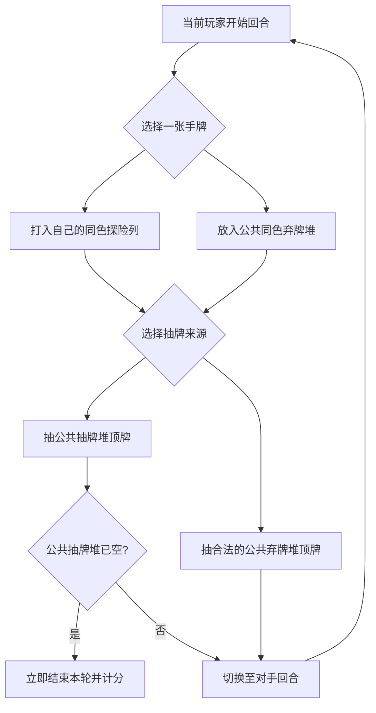

# Lost Cities（失落的城市）游戏规则

> 适用版本：经典双人、五色、60 张卡牌版（不含第六色扩展及其他同名桌游）。
> 用途：玩家规则说明、线上小游戏开发及规则验收。
> 本文以发行商规则手册为依据重新组织；第 9 节中的线上产品约定并非原版强制规则。

## 1. 游戏概述

- 玩家人数：2 人。
- 游戏类型：回合制、非完全信息、策略卡牌对战。
- 游戏目标：经营不同颜色的探险路线，取得尽可能高的总分。
- 标准比赛：3 轮，每轮重新洗牌、发牌，累计三轮得分决定胜负。
- 可选快速模式：仅进行 1 轮（线上产品配置）。
- 握手牌（Wager / Investment Card）代表探险投资，只影响游戏分数，不涉及真实货币。

本文使用“比赛”指完整对局，“轮”指一次发牌至结算的过程，“回合”指单个玩家的一次行动。

## 2. 卡牌及游戏区域

### 2.1 卡牌组成

| 颜色 | 数字牌 | 握手牌 | 总数 |
| --- | --- | ---: | ---: |
| 红 | 2、3、4、5、6、7、8、9、10 | 3 | 12 |
| 黄 | 2、3、4、5、6、7、8、9、10 | 3 | 12 |
| 蓝 | 2、3、4、5、6、7、8、9、10 | 3 | 12 |
| 绿 | 2、3、4、5、6、7、8、9、10 | 3 | 12 |
| 白 | 2、3、4、5、6、7、8、9、10 | 3 | 12 |
| 合计 | 45 张 | 15 | 60 |

每种颜色的每个数字只有一张；三张握手牌功能相同，但在程序内部应有不同 ID。经典版没有数字 1、万能牌或额外行动牌。

### 2.2 游戏区域

| 区域 | 数量 | 可见性 | 用途 |
| --- | ---: | --- | --- |
| 玩家手牌 | 每人一组 | 仅本人可见牌面 | 待打出的牌 |
| 玩家探险列 | 每人五列 | 双方可见全部已打出的牌 | 按颜色累积得分 |
| 公共弃牌堆 | 五堆，每色一堆 | 双方只可见各堆顶牌（本产品改为暗置，见 §9.3） | 接收弃牌、供双方抽取 |
| 公共抽牌堆 | 一堆 | 牌面及顺序隐藏 | 提供未知的新牌 |

双方各有独立的五列探险，但共享抽牌堆和弃牌堆。同一种颜色可以同时由双方经营。

## 3. 游戏准备

1. 清空双方手牌、探险列、公共弃牌堆及上一轮的牌堆状态。
2. 将全部 60 张牌充分洗匀。
3. 向两名玩家各发 8 张私有手牌。
4. 剩余 44 张组成公共抽牌堆，牌面朝下。
5. 确定本轮先手：原版首轮由年长者先手，后续由上一轮结算后分数领先的玩家先手；线上先手细则见第 9 节。
6. 进入第一个玩家的回合。

新一轮不会保留前一轮的手牌、探险或弃牌，只有比赛累计分及轮次信息保留。

## 4. 回合流程

双方交替行动。每个正常回合必须依次完成两个操作：先处理一张手牌（打出或弃掉），再抽取一张牌。



回合开始时有 8 张手牌，打出或弃掉后剩 7 张，抽牌后恢复至 8 张。不能跳过行动、先抽后打、一回合出多张牌，或在抽牌之后继续打牌。

### 4.1 第一步：打出或弃掉一张牌（二选一）

- 打出：将手牌放入自己的同色探险列，须满足第 5 节的出牌限制。
- 弃掉：将手牌放到同色公共弃牌堆顶部。任何手牌均可弃掉，不要求符合探险列的数字顺序。

一张牌只能进入一个区域。已打入探险列的牌不可取回、移动或弃掉。

### 4.2 第二步：抽一张牌

可从以下来源中选择一个：

- 公共抽牌堆的顶牌（抽前不知道是什么牌）；
- 任意非空的公共弃牌堆顶牌（原版抽前知道是什么牌；本产品弃牌暗置，抽前只知道颜色，见 §9.3）。

禁止抽回自己本回合刚弃掉的那张牌。由于它位于对应弃牌堆顶部，本回合也不能从该颜色的弃牌堆抽取被它覆盖的牌。

其他颜色的弃牌堆、公共抽牌堆仍可正常抽取。下一回合起，该弃牌可被任何玩家合法抽取（包括此前弃掉它的玩家），前提是它仍在堆顶且不是该玩家当回合刚弃的牌。

抽自弃牌堆时，堆顶牌移入手牌，下一张自动成为新堆顶；不能挑选堆内任意牌，也不能额外抽牌。

## 5. 探险出牌规则

### 5.1 数字牌

每一列只能放对应颜色的牌，数字牌必须严格递增，但不需要连续。新牌只能追加至该列末尾。

例如：

| 当前红色探险列 | 拟打出的牌 | 合法性 |
| --- | --- | --- |
| 空 | 红 5 | 合法，可从任意数字开始 |
| 红 3、红 5 | 红 8 | 合法，允许跳过 6、7 |
| 红 3、红 5 | 红 4 | 非法，不允许回填 |
| 红 3、红 5 | 蓝 8 | 非法，颜色不一致 |
| 红 10 | 红 9 | 非法，10 已为最高数字 |

若跳过较小数字，之后不能补入该探险列，但仍可留在手中或弃掉。

### 5.2 握手牌

握手牌只能放在同色探险列的所有数字牌之前。一列可以有 0 至 3 张握手牌，每回合仍只能打出一张。

- 空探险列可以用握手牌开启。
- 仅有握手牌的列可以继续追加同色握手牌，也可以追加任意同色数字牌。
- 一旦出现第一张数字牌，该列本轮永久关闭握手牌入口。
- 握手牌无数字分值，但会启动探险成本，并计入列的卡牌总数。

合法：`握手 → 握手 → 3 → 6 → 9`。

非法：`3 → 握手`、`握手 → 6 → 4`。

## 6. 本轮结束条件

当任意玩家从公共抽牌堆抽走最后一张牌时，本轮立即结束。

最后一张牌进入该玩家手牌，但不能再打出；对手也没有补偿回合。即使仍有公共弃牌可抽，亦不得继续。

以下情况不会结束一轮：某列已经打到 10、某玩家五列均已开启、某一弃牌堆清空，或双方手牌无法合法打入探险列（仍可弃牌）。

公共抽牌堆剩余数量可以公开用于规划；只抽弃牌不会减少公共抽牌堆的数量，因此一轮不必恰好进行 44 个回合。

## 7. 得分结算

### 7.1 单列计分

分别对每名玩家的五种颜色进行计算：

- 空列：0 分，不产生探险成本。
- 非空列：数字总和减去 20 分固定成本，再应用握手牌倍率；达到卡牌数量要求时加固定奖励。

定义：`S` 为数字牌点数总和，`W` 为握手牌张数，`N` 为本列所有牌（含握手牌）的数量。

```text
N = 0: score = 0
N > 0: score = (S - 20) × (W + 1) + (N >= 8 ? 20 : 0)
```

### 7.2 握手牌倍率

| 握手牌数量 | 倍率 |
| ---: | ---: |
| 0 | ×1 |
| 1 | ×2 |
| 2 | ×3 |
| 3 | ×4 |

倍率同时放大正分和负分，并非每张握手牌独立乘 2。三张握手牌为四倍，而非八倍。

### 7.3 长探险奖励

单列至少有 8 张牌时，获得一次 20 分奖励。握手牌计入张数；奖励在倍率运算完成后再加，不参与翻倍。9 张以上也只奖励一次，不能跨颜色合并张数。

### 7.4 计分示例

`H` 代表一张握手牌。下表各行是独立示例。

| 探险列 | 数字和 | 倍率 | 奖励 | 得分 |
| --- | ---: | ---: | ---: | ---: |
| 空 | 0 | — | 0 | 0 |
| H | 0 | 2 | 0 | -40 |
| H、H、H | 0 | 4 | 0 | -80 |
| 3、7、9 | 19 | 1 | 0 | -1 |
| 2、8、10 | 20 | 1 | 0 | 0 |
| 6、8、10 | 24 | 1 | 0 | 4 |
| H、4、6 | 10 | 2 | 0 | -20 |
| H、H、7、9、10 | 26 | 3 | 0 | 18 |
| 2、3、4、5、6、7、8、9 | 44 | 1 | 20 | 44 |
| H、H、2、3、4、5、6、7 | 27 | 3 | 20 | 41 |
| H、H、H、2、3、4、5、6 | 20 | 4 | 20 | 20 |

### 7.5 单轮总分

将玩家五列得分直接相加。手牌、抽牌堆、弃牌堆中的牌均不计分。负分不归零，也不额外扣除手牌分数。

例如：红色 18 分、黄色 -20 分、蓝色 41 分、绿色 0 分、白色 4 分，则该玩家本轮为 43 分。

## 8. 比赛胜负

标准比赛进行三轮。每轮结算后记录双方本轮分数，更新累计分；未达到设定轮数时重新洗牌并开始下一轮。

比赛总分 = 各轮分数之和。最终总分较高者获胜，而不是获胜轮数较多者获胜。

| 玩家 | 第 1 轮 | 第 2 轮 | 第 3 轮 | 总分 | 结果 |
| --- | ---: | ---: | ---: | ---: | --- |
| A | 30 | -10 | 42 | 62 | 胜 |
| B | 32 | 0 | 20 | 52 | 负 |

A 只赢了第三轮，但比赛总分更高，仍获胜。双方总分均为负数时，也按数值大小比较。

原版手册未明确同分的细则，线上版本默认总分相同判为平局。

## 9. 线上游戏补充约定（非原版强制规则）

### 9.1 默认配置

| 配置项 | 推荐默认值 |
| --- | --- |
| 比赛轮数 | 3；快速模式 1 |
| 首轮先手 | 服务器随机确定 |
| 后续轮先手 | 当前比赛累计分较高者；累计分相同则与上一轮交换先手 |
| 最终同分 | 平局，不增加决胜轮 |
| 回合时间 | 30 秒，处理牌与抽牌共享倒计时 |
| 牌堆剩余数量 | 公开 |
| 弃牌可见性 | 暗置：只公开各色弃牌堆的张数，不公开牌面（含堆顶） |
| 实时探险分数 | 可公开显示，标记为当前预估分 |
| 回合超时 | 自动完成尚未完成的合法操作 |
| 掉线 | 允许重连，倒计时继续 |
| 主动认输 | 当前比赛直接判负 |

原版后续轮由分数领先者先手，但未细化多轮累计分与上一轮分数的区别；本产品选择累计分作为明确依据。首轮随机先手替代年龄判断。

### 9.2 超时及异常处理

- 尚未打出或弃牌：服务器从当前手牌随机选一张弃掉，再从公共抽牌堆抽一张。
- 已处理手牌但尚未抽牌：服务器自动从公共抽牌堆抽一张。
- 超时操作与正常操作使用相同合法性校验；抽到最后一张即结算。
- 非当前玩家请求、重复请求、非法出牌均拒绝，状态不变。
- 重连恢复当前轮次、回合阶段、倒计时及本人合法可见的数据，不重新发牌。
- 为防止双方长期循环抽弃牌，可增加独立的比赛时长上限；若启用，建议超限时判该比赛无结果，而不是悄悄改变原版抽牌结束条件。默认不启用。

### 9.3 信息权限

| 信息 | 玩家本人 | 对手 |
| --- | --- | --- |
| 本人手牌牌面 | 可见 | 不可见 |
| 本人手牌数量 | 可见 | 可见 |
| 双方探险列 | 可见 | 可见 |
| 各色弃牌堆张数 | 可见 | 可见 |
| 弃牌牌面（含堆顶） | 不可见（本人弃出的牌本人知道） | 不可见 |
| 公共抽牌堆牌面及顺序 | 不可见 | 不可见 |
| 公共抽牌堆剩余数量 | 可见 | 可见 |
| 回合、轮次、公开操作及分数 | 可见 | 可见 |

本产品弃牌暗置（与原版不同）：弃牌时对手只知道颜色（弃牌堆按颜色区分），不知道数字；从弃牌堆抽牌时只能按颜色选择，盲抽该堆堆顶，抽到的牌只有抽牌者可见。出牌、抽牌限制（§4.2 不能抽回本回合刚弃的牌、只能拿堆顶）不变。实时事件不得向对手泄露弃牌或从任一牌堆抽得的具体卡牌。

## 10. 规则引擎实现约束

### 10.1 状态机

```text
MATCH_SETUP
  → ROUND_SETUP
  → PLAY_OR_DISCARD
  → DRAW
  → PLAY_OR_DISCARD（切换玩家）
  → ...
  → ROUND_SCORING（抽牌堆空）
  → ROUND_SETUP（还有剩余轮数） / MATCH_END
```

### 10.2 最小状态

- 比赛：玩家 ID、总轮数、当前轮次、累计得分、比赛状态。
- 本轮：当前玩家、先手玩家、当前回合阶段、抽牌堆、五个弃牌堆、双方手牌、双方五列探险、当前回合弃牌 ID。
- 卡牌：唯一 ID、颜色、类型（数字 / 握手）、数字值（握手牌无数字值）。

核心动作：`playCard(cardId)`、`discardCard(cardId)`、`drawFromDeck()`、`drawFromDiscard(color)`。动作由服务端验证玩家、阶段、牌权属和目标合法性后执行。

### 10.3 状态不变量

- 一轮内 60 张卡牌各只存在于一个区域，任何动作不能复制或丢失卡牌。
- 回合开始和正常结束时双方手牌各 8 张；打牌后待抽阶段当前玩家为 7 张。
- 探险列按颜色隔离；握手牌均在数字牌之前，数字牌严格递增。
- 弃牌堆按颜色隔离，遵循后进先出（LIFO）。
- 抽牌堆耗尽后不再接受本轮行动；一轮只计分一次。
- 服务端掌握完整状态，客户端仅获得当前身份可见的视图。

## 11. 规则验收用例

| 编号 | 场景 | 预期结果 |
| --- | --- | --- |
| T01 | 开始新一轮 | 双方各 8 张，抽牌堆 44 张，其他区为空 |
| T02 | 空列打任意同色数字 | 成功，开启该探险 |
| T03 | 3 后打 8 | 成功 |
| T04 | 8 后打 6 | 拒绝，状态不变 |
| T05 | 把蓝牌打入红列 | 拒绝 |
| T06 | 空列打握手，再打同色握手 | 两个独立回合均合法 |
| T07 | 数字牌后打握手 | 拒绝 |
| T08 | 将不能打入探险的牌弃掉 | 成功，放在同色弃牌堆顶部 |
| T09 | 同回合立即抽回刚弃的牌 | 拒绝 |
| T10 | 弃红牌后抽蓝色弃牌堆顶 | 蓝堆非空时成功 |
| T11 | 尝试抽弃牌堆第二张 | 拒绝 |
| T12 | 下一回合抽先前弃掉的牌 | 若为合法堆顶则成功 |
| T13 | 未打牌就抽牌 | 拒绝 |
| T14 | 打牌后再次打牌而未抽牌 | 拒绝 |
| T15 | 从弃牌堆抽牌 | 公共抽牌堆数量不变 |
| T16 | 抽走公共抽牌堆最后一张 | 本轮立即结束，不再给对手回合 |
| T17 | 空探险列 | 0 分 |
| T18 | 仅三张握手牌 | -80 分 |
| T19 | 两张握手、数字和 26 | 若总张数不足 8，则 18 分 |
| T20 | 两张握手、2 至 7 | 8 张牌，得 41 分 |
| T21 | 握手三张、数字 2 至 6 | 8 张牌，得 20 分（奖励不翻倍） |
| T22 | 未打出的手牌含高分牌 | 不计分 |
| T23 | 非当前玩家提交操作 | 拒绝 |
| T24 | 三轮得分高但只胜一轮 | 累计分高者赢得比赛 |
| T25 | 双方最终累计分相同 | 判平局（产品约定） |
| T26 | 已打牌但抽牌超时 | 仅自动抽牌，不重复出牌 |
| T27 | 本轮结算后重放抽牌请求 | 拒绝，不重复计分 |

## 12. 参考资料

- [Thames & Kosmos 官方规则手册（691821，2018 英文版，含经典五色基础规则）](https://www.thamesandkosmos.com/manuals/full/691821_LC_Card_Game.pdf)，重点为第 2–3 页。
- [发行商产品页面：Lost Cities – Card Game](https://thamesandkosmos.com/collections/2-player/products/lost-cities-card-game-with-6th-expedition)，用于确认五色基础版与扩展版的区别。
- [经典五色版规则存档（University of Waterloo）](https://cs.uwaterloo.ca/~dtompkin/archive/dtlib/base/Lost%20Cities.pdf)。
- [UltraBoardGames 规则参考](https://www.ultraboardgames.com/lost-cities/game-rules.php)。

如计划公开发行商业小游戏，规则描述、游戏名称、原版插画及其他素材的使用许可应分别确认；本文不代表取得任何授权。
