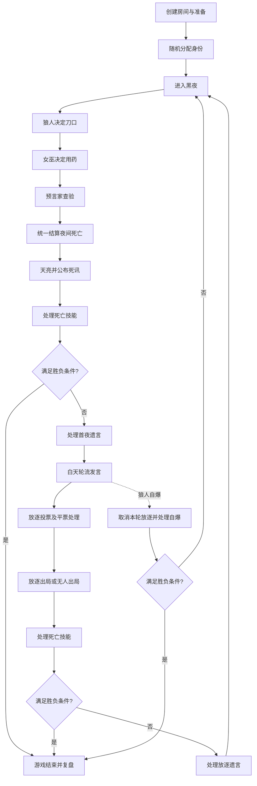

# 狼人杀游戏规则：6 人局与 9 人局

> 版本：v1.0  
> 适用范围：6 人预女局、9 人预女猎局；线上游戏、线下主持及游戏规则实现。

本文以国内常见狼人杀玩法为基础，定义两种可直接执行的板子规则。狼人杀并无覆盖所有平台的统一规则；本文中的人数配置、无警长、全程不可自救、胜负冲突处理及超时策略均为本游戏的默认约定，而非所有平台的强制标准。开局后不得修改规则。

## 1. 游戏概述

狼人杀是一款隐藏身份、阵营对抗的回合制游戏。玩家随机获得身份，游戏从黑夜开始，随后在白天和黑夜之间交替进行，直至满足胜负条件。

- 好人阵营：平民及神职，目标是淘汰所有狼人。
- 狼人阵营：普通狼人，目标是淘汰所有平民或所有神职（屠边）。
- 本规则不包含第三方阵营、守卫、警长、警徽及其他扩展角色。
- 采用暗牌模式：除狼人自爆等规则明确要求公开身份的情况外，玩家出局时不公开真实身份。

## 2. 板子配置

### 2.1 6 人局：预女局

| 角色 | 阵营 | 类型 | 数量 |
| --- | --- | --- | ---: |
| 狼人 | 狼人 | 狼职 | 2 |
| 平民 | 好人 | 民职 | 2 |
| 预言家 | 好人 | 神职 | 1 |
| 女巫 | 好人 | 神职 | 1 |
| 合计 | | | 6 |

- 好人 4 人，狼人 2 人。
- 夜间行动角色：狼人、女巫、预言家。
- 默认不设置警长。
- 好人获胜：2 名狼人全部出局。
- 狼人获胜：2 名平民全部出局，或预言家与女巫全部出局。

### 2.2 9 人局：预女猎局

| 角色 | 阵营 | 类型 | 数量 |
| --- | --- | --- | ---: |
| 狼人 | 狼人 | 狼职 | 3 |
| 平民 | 好人 | 民职 | 3 |
| 预言家 | 好人 | 神职 | 1 |
| 女巫 | 好人 | 神职 | 1 |
| 猎人 | 好人 | 神职 | 1 |
| 合计 | | | 9 |

- 好人 6 人，狼人 3 人。
- 夜间行动角色：狼人、女巫、预言家。猎人仅在需要时获得开枪状态提示。
- 默认不设置警长。
- 好人获胜：3 名狼人全部出局。
- 狼人获胜：3 名平民全部出局，或预言家、女巫、猎人全部出局。

### 2.3 板子差异

| 规则 | 6 人局 | 9 人局 |
| --- | --- | --- |
| 狼人 | 2 | 3 |
| 平民 | 2 | 3 |
| 神职 | 2 | 3 |
| 猎人及开枪结算 | 无 | 有 |
| 警长 | 无 | 无 |
| 放逐票权 | 每人 1 票 | 每人 1 票 |
| 胜负模式 | 屠边 | 屠边 |

## 3. 角色规则

### 3.1 狼人

适用：6 人局、9 人局。

- 游戏开始后，狼人知道其他狼人队友的身份；不知道好人的具体身份。
- 每个夜晚，存活狼人通过专属频道讨论，共同决定袭击一名存活玩家。整个狼队每晚最多产生一个狼刀目标。
- 可以袭击好人、狼人队友或自己（自刀），也可以选择不袭击（空刀）。
- 白天可以正常发言、投票、伪装身份，也可以在允许的阶段主动自爆。
- 狼人出局后不再参与狼队讨论及后续夜间行动。

#### 狼刀决策

1. 所有存活狼人均有一票，可选择任意存活玩家或明确选择空刀。
2. 在行动结束或全部狼人提交后统计票数；唯一最高票选项生效（空刀亦为选项）。
3. 最高票并列时，仅在并列选项中重新投票一次；再次并列则空刀。
4. 未提交视为弃权，不等同于明确投空刀；没有有效票时空刀。
5. 仅有一名存活狼人时，由该狼人独立选择。
6. 刀口确认后不可撤回；女巫只能看到最终刀口，不能看到狼队投票过程。

### 3.2 平民

适用：6 人局、9 人局。

- 属于好人阵营，无夜间主动技能。
- 默认只知道自身身份和所有公共信息。
- 白天正常发言、推理和投票。
- 平民全部出局时，满足狼人屠边胜利条件。

### 3.3 预言家

适用：6 人局、9 人局。

- 每晚最多查验一名其他存活玩家。
- 查验结果为「好人」或「狼人」，不提供具体角色。
- 可以重复查验此前查验过的存活玩家；不可查验自己或已经出局的玩家。
- 可以放弃查验；未操作视为放弃。
- 查验结果仅预言家本人可见。白天是否公开或如何描述结果，由玩家自行决定。
- 当晚即将死亡但夜间开始时仍存活的预言家，可以正常查验。

### 3.4 女巫

适用：6 人局、9 人局。

女巫拥有一瓶解药和一瓶毒药，两者整局各可使用一次，使用后不恢复。

| 规则 | 解药 | 毒药 |
| --- | --- | --- |
| 使用阶段 | 夜间 | 夜间 |
| 使用目标 | 本晚狼刀目标（不能是自己） | 任意其他存活玩家 |
| 效果 | 抵消本晚狼刀 | 使目标死亡 |
| 初始次数 | 1 | 1 |
| 是否可放弃 | 是 | 是 |

限制：

- 同一夜最多使用一种药，不能同时使用解药和毒药。
- 默认全程不可自救，包括首夜。
- 有解药时可查看当晚狼刀目标；没有狼刀时显示空刀。
- 解药已经用完后，不再获得狼刀信息，但仍可使用未消耗的毒药。
- 解药仅抵消普通狼刀，不能救被毒杀、白天放逐、自爆或猎人开枪带走的玩家。
- 可以使用解药救自刀的狼人，药物仍正常消耗。
- 允许毒杀狼人、平民和其他神职，不允许毒杀自己。
- 女巫当晚被狼人袭击时，可以使用剩余毒药；毒药不会因女巫本晚死亡而失效。
- 提交合法用药行动后扣减对应药物次数；超时或放弃不消耗药物。

### 3.5 猎人

仅适用：9 人局。

猎人属于好人阵营，拥有一次死亡触发技能。在符合条件的死亡场景下，可以选择一名尚未出局的玩家开枪，将其带走。

| 死亡原因 | 能否开枪 |
| --- | --- |
| 狼刀死亡 | 可以 |
| 白天投票放逐 | 可以 |
| 女巫毒杀 | 不可以 |
| 同时遭受狼刀和毒药 | 不可以，毒杀限制优先 |

其他规则：

- 开枪是可选行动，允许主动放弃；超时视为放弃。
- 不得向自己、已死亡玩家或本批次已确定死亡的玩家开枪。
- 开枪可以带走好人或狼人；无法被女巫解药抵消。
- 开枪行动及目标公开；此时猎人身份自然公开。猎人未开枪时不额外公开身份。
- 猎人是最后一名神职时，仍先处理符合条件的开枪技能，再统一判断胜负。
- 本板子只有一名猎人，不存在多名猎人相互触发的情况。

## 4. 游戏准备与身份分配

1. 房间选择 6 人或 9 人板子，确定全部规则参数。
2. 对应人数的玩家入座并准备；座位编号从 1 开始。
3. 游戏开始后锁定座位、角色数量和规则配置。
4. 随机打乱对应板子的身份牌，为每个玩家分配一个身份。
5. 私下通知每个玩家自身身份；狼人队友名单仅发给狼队。
6. 首夜开始，此时所有玩家均存活。

## 5. 完整游戏流程

说明：死亡技能仅在角色存在且满足触发条件时处理。若当前结算已经产生游戏结果，直接结束游戏，不再开启新的遗言、发言或投票环节。

## 6. 黑夜阶段

### 6.1 行动顺序

| 顺序 | 阶段 | 行动内容 |
| ---: | --- | --- |
| 1 | 天黑 | 关闭公开发言，开启本轮夜间行动 |
| 2 | 狼人 | 狼队讨论并确定唯一刀口或空刀 |
| 3 | 女巫 | 查看符合权限的刀口信息，决定是否用药 |
| 4 | 预言家 | 查验一名其他存活玩家或放弃 |
| 5 | 夜间结算 | 计算最终死亡名单及死亡原因 |
| 6 | 猎人状态 | 9 人局中向猎人私下提供必要的开枪资格信息 |
| 7 | 天亮 | 进入死亡公告阶段 |

已出局角色不再行动。为避免通过等待时长推断神职是否存活，线上实现应隐藏夜间具体行动角色和进度，并采用固定或不可推断的公开阶段时长。

### 6.2 行动与结算分离

夜间角色的行动顺序不代表立即生效顺序。夜间开始时存活的玩家，在本轮夜间结算前仍拥有自身角色的合法行动资格。

例如狼人袭击女巫，女巫毒杀预言家，预言家仍可查验。最终统一结算时，女巫和预言家均出局，查验及用药均有效。

### 6.3 夜间死亡结算

1. 记录本晚最终狼刀目标（可能为空）。
2. 如果女巫合法使用解药，抵消对应狼刀。
3. 如果女巫合法使用毒药，加入毒杀目标。
4. 合并未被抵消的狼刀目标与毒杀目标，生成去重后的死亡名单。
5. 保留每个目标的所有有效死亡原因，用于猎人资格判定。
6. 将本批死亡玩家同时标记为出局，随后公布死讯并处理死亡技能。

| 场景 | 最终结果 |
| --- | --- |
| 空刀，女巫不用药 | 平安夜 |
| 狼刀 A，女巫不用药 | A 死亡 |
| 狼刀 A，女巫使用解药 | 平安夜 |
| 空刀，女巫毒 B | B 死亡 |
| 狼刀 A，女巫毒 B（A、B 不同） | A、B 同时死亡 |
| 狼刀 A，女巫毒 A | A 只出局一次，记录狼刀及毒杀两种原因 |

6 人、9 人局均没有守卫，因此不存在同守同救（奶穿）结算。

## 7. 天亮与死亡处理

### 7.1 公布死讯

- 无人死亡：公布「昨晚是平安夜」。
- 一人死亡：公布对应座位号。
- 多人死亡：按座位编号升序公布全部死者，不能按死亡原因排序。
- 暗牌模式下不公布夜间死亡原因、狼刀目标、用药情况及死者身份。
- 同一玩家受到多个致死效果时，只公布一次死亡。

### 7.2 死亡技能

9 人局中，如死亡名单包含猎人且猎人具备开枪资格，则暂停后续流程，询问是否开枪；选择合法目标后立即公布枪杀结果并将目标标记为出局。若放弃或超时，不新增死亡。

6 人局不存在死亡技能。死亡技能处理完毕后，统一判断本批次胜负；如果未结束，再处理遗言和普通发言。

### 7.3 遗言

| 死亡场景 | 是否有遗言 |
| --- | --- |
| 首夜狼刀死亡 | 有 |
| 首夜毒杀死亡 | 有 |
| 第二夜及以后夜间死亡 | 无 |
| 白天投票放逐 | 有 |
| 猎人开枪带走 | 无 |
| 狼人自爆 | 无 |

首夜多人死亡且游戏未结束时，按座位号升序发表遗言。枪杀目标不继承首夜遗言权限。游戏已结束时不另行安排正式遗言，可进入复盘交流。

### 7.4 出局限制

出局玩家不得参加后续普通发言、投票、夜间角色行动或狼队交流。仅可执行尚未处理的合法死亡技能、遗言，以及观看游戏。线上游戏应隔离存活玩家和观战/死亡玩家频道。

## 8. 白天发言阶段

### 8.1 发言顺序

本规则默认没有警长，每轮发言顺序由系统确定。

- 有夜间直接死亡玩家时：以编号最小的夜间死者为锚点，从其下一位顺时针存活玩家开始。
- 平安夜：从上一轮普通发言起点的下一位顺时针存活玩家开始；若不存在上一轮，则从最小存活座位号开始。
- 按座位编号循环递增发言，最大编号的下一位为 1 号，跳过所有出局玩家。
- 每名存活玩家在本轮普通发言阶段最多发言一次。发言顺序在阶段开始时确定并公开。

### 8.2 发言约束

- 仅轮到的玩家拥有公开发言权；其他玩家不得插话。
- 玩家可以提前结束发言，超时由系统自动结束。
- 玩家可以声明任意身份，也可以说谎、质疑其他玩家和提出投票建议。
- 禁止利用游戏外通讯、窥屏、系统漏洞或其他场外信息破坏游戏公平性。
- 全部存活玩家发言完毕后，进入放逐投票；狼人自爆时可提前中断普通发言。

## 9. 放逐投票阶段

### 9.1 第一轮投票

- 所有存活玩家均有且仅有 1 票。
- 可以投给任意其他存活玩家，也可以弃票；不能投给自己或已出局玩家。
- 投票开始后同时收集各玩家的选择，期间不公开其他玩家的票型。
- 确认提交后不可更改；超时视为弃票。
- 全员提交或投票计时结束后，统一公布每个玩家的投票对象及票数统计。
- 唯一最高有效票且至少获得 1 票的玩家被放逐，无需过半数。
- 若最高有效票并列，则进入 PK；全员弃票时直接无人出局。

### 9.2 PK 与第二轮投票

1. 第一轮最高票并列的玩家进入 PK，按照座位编号升序依次进行补充发言。
2. 所有仍存活的非 PK 玩家进行第二轮投票，只能选择 PK 候选人或弃票；PK 玩家没有第二轮投票权。
3. 第二轮唯一最高有效票且至少获得 1 票的候选人被放逐。
4. 第二轮再次平票、全员弃票或没有合法投票人时，本轮无人出局。
5. 每个白天最多进行一次 PK 重投，不进行无限次重投。

### 9.3 放逐结算

有放逐目标时，将其标记为出局并公开座位号，不主动公开身份。9 人局中如果目标是猎人，处理开枪技能。随后检查胜负；未结束则允许放逐玩家发表遗言，并进入下一夜。

无人出局时，检查胜负后直接进入下一夜，不产生遗言。

## 10. 狼人自爆

- 仅存活狼人可以主动自爆。
- 默认允许在白天普通发言及 PK 发言阶段自爆，不要求轮到自己发言。
- 夜间、投票阶段、死亡技能阶段、遗言阶段以及游戏结束后均不允许自爆。
- 自爆立即公开狼人身份，该狼人出局；终止当前发言及尚未完成的放逐流程，包括未完成的 PK。
- 自爆不产生遗言，不允许指定下一晚刀口。
- 结算自爆死亡后立即判断胜负；若未结束，直接进入下一夜。
- 多个狼人同时提交自爆时，以服务端接受的第一个合法行动为准，其他请求因阶段变化而失效。

## 11. 胜负判定

### 11.1 默认屠边模式

定义：

- W：存活狼人数量。
- V：存活平民数量。
- G：存活神职数量。

| 判定条件 | 结果 |
| --- | --- |
| W = 0，且 V > 0、G > 0 | 好人胜利 |
| W > 0，且 V = 0 或 G = 0 | 狼人胜利 |
| W = 0，且 V = 0 或 G = 0 | 平局（本游戏约定） |
| W > 0、V > 0、G > 0 | 游戏继续 |

狼人与好人人数相同或狼人数量超过好人，不直接触发胜利。本游戏不是人数优势胜利模式。

### 11.2 判定时机与优先级

- 夜间统一死亡及其死亡技能全部结算后。
- 白天放逐及其死亡技能全部结算后。
- 狼人自爆结算后。
- 无人出局的白天结束时（防御性检查）。

先完成当前批次的死亡与死亡触发技能，再依据最终存活人数统一判断胜负。中间状态不提前锁定胜者；胜负判定完成后不可继续执行新的游戏行动。

这意味着最后一名神职为猎人时，符合条件仍可以开枪；若其带走最后一名狼人，则双方同时满足胜利条件，判定平局。不同狼人杀平台对此存在不同裁定，本文采用此明确约定。

### 11.3 示例

| 场景 | W | V | G | 结果 |
| --- | ---: | ---: | ---: | --- |
| 所有狼人被淘汰 | 0 | 1 | 1 | 好人胜利 |
| 所有平民被淘汰 | 1 | 0 | 2 | 狼人胜利 |
| 所有神职被淘汰 | 1 | 2 | 0 | 狼人胜利 |
| 狼人取得人数优势，但仍有民、神 | 3 | 1 | 1 | 继续游戏（仅 9 人局可出现 3 狼） |
| 最后一狼与最后一神同批死亡 | 0 | 1 | 0 | 平局 |

### 11.4 游戏结束

系统停止所有行动和倒计时，公布获胜阵营或平局、全体身份、死亡原因、夜间技能、狼队行动、公开投票和事件时间线，进入复盘。仅公开游戏内数据，不公开玩家隐私或非游戏内容。

## 12. 信息可见性

| 信息 | 平民 | 狼人 | 预言家 | 女巫 | 猎人 |
| --- | --- | --- | --- | --- | --- |
| 自己的身份 | 是 | 是 | 是 | 是 | 是 |
| 狼队成员身份 | 否 | 是 | 否 | 否 | 否 |
| 狼队夜间讨论及刀口 | 否 | 是 | 否 | 仅剩余解药时可见刀口 | 否 |
| 查验目标及结果 | 否 | 否 | 是 | 否 | 否 |
| 女巫剩余药物及操作 | 否 | 否 | 否 | 是 | 否 |
| 猎人开枪资格 | 否 | 否 | 否 | 否 | 是 |
| 公开发言、死讯、放逐票型 | 是 | 是 | 是 | 是 | 是 |
| 全体真实身份、完整行动记录 | 游戏结束后 | 游戏结束后 | 游戏结束后 | 游戏结束后 | 游戏结束后 |

猎人列仅适用于 9 人局。玩家通过发言获知的身份声明不等同于系统认证信息。女巫所见的刀口不代表最终死亡结果。

线上实现时，隐藏身份、夜间行动、原始死亡原因等数据必须由服务端按接收者权限过滤，不得先发送到客户端再通过 UI 隐藏。死亡玩家默认以公共信息观战，不额外获知其他活人的身份。

## 13. 时间限制与异常处理

下列为线上游戏的推荐默认值，并非传统狼人杀固定时长。

| 操作 | 默认时限 | 超时处理 |
| --- | ---: | --- |
| 狼队讨论及选人 | 40 秒 | 按有效票统计；无票则空刀 |
| 狼队刀口重投 | 15 秒 | 再次平票或无票则空刀 |
| 女巫用药 | 20 秒 | 不用药 |
| 预言家查验 | 20 秒 | 不查验 |
| 猎人开枪 | 15 秒 | 放弃开枪 |
| 普通发言 | 60 秒 | 自动结束 |
| PK 发言 | 30 秒 | 自动结束 |
| 第一轮/第二轮放逐投票 | 各 15 秒 | 弃票 |
| 遗言 | 30 秒 | 自动结束 |

异常规则：

- 掉线不等于死亡，保留身份及座位，允许玩家重连；游戏倒计时继续运行。
- 退出房间不自动触发出局，未完成的行动按照超时规则处理。
- 重连时仅同步该玩家有权查看的当前游戏状态及必要历史事件，不恢复已结束的行动窗口。
- 超时、重复提交、过期请求及非法目标不得产生额外技能消耗或重复结算。
- 防止无限空刀、弃票导致游戏无法结束：默认连续 3 个完整昼夜（从夜间开始至白天结束）没有任何玩家死亡时，判定为无结果结束；任一死亡发生即清零该计数。该机制是线上产品约定，与正常胜负平局区分。
- 服务端故障无法恢复游戏时标记为无效局，不强制判定任何阵营胜利。

## 14. 默认规则汇总

| 配置项 | 6 人局 | 9 人局 |
| --- | --- | --- |
| 身份组合 | 2 狼 + 2 民 + 预言家 + 女巫 | 3 狼 + 3 民 + 预言家 + 女巫 + 猎人 |
| 身份公开模式 | 暗牌 | 暗牌 |
| 起始阶段 | 黑夜 | 黑夜 |
| 胜利模式 | 屠边 | 屠边 |
| 警长 | 无 | 无 |
| 狼队每晚刀口数 | 1 | 1 |
| 允许空刀、自刀 | 是 | 是 |
| 允许狼人自爆 | 是 | 是 |
| 自爆遗言、指刀 | 否 | 否 |
| 预言家重复查验 | 是 | 是 |
| 预言家自查 | 否 | 否 |
| 女巫解药、毒药次数 | 各 1 | 各 1 |
| 女巫同夜双药 | 否 | 否 |
| 女巫自救 | 全程禁止 | 全程禁止 |
| 女巫毒自己 | 否 | 否 |
| 解药用完后查看刀口 | 否 | 否 |
| 猎人开枪 | 不适用 | 狼刀、放逐可开枪；毒杀不可 |
| 每人放逐票权 | 1 | 1 |
| 允许弃票 / 自投 | 是 / 否 | 是 / 否 |
| 放逐平票重投次数 | 1 | 1 |
| 再次平票 | 无人出局 | 无人出局 |
| 首夜死亡遗言 | 有（枪杀除外） | 有（枪杀除外） |
| 后续夜间死亡遗言 | 无 | 无 |
| 放逐遗言 | 有 | 有 |
| 死亡技能优先于胜负判定 | 不适用 | 是 |
| 同批次双方满足胜利条件 | 平局 | 平局 |
| 连续无死亡结束阈值 | 3 个完整昼夜 | 3 个完整昼夜 |

## 15. 关键规则验收用例

| 编号 | 适用板子 | 场景 | 预期结果 |
| --- | --- | --- | --- |
| T01 | 两者 | 狼人袭击 A，女巫救 A | 平安夜，解药消耗 |
| T02 | 两者 | 女巫同夜尝试提交两种药 | 第二种用药请求被拒绝 |
| T03 | 两者 | 狼人袭击女巫，女巫尝试自救 | 拒绝自救，可改用毒药或放弃 |
| T04 | 两者 | 狼人袭击女巫，女巫毒 B | 女巫、B 同时死亡 |
| T05 | 两者 | 狼刀与毒药命中同一玩家 | 只出局一次，保留两种死亡原因 |
| T06 | 两者 | 解药已耗尽 | 女巫无法查看刀口，剩余毒药可用 |
| T07 | 两者 | 狼人最高票并列且重投仍平票 | 空刀 |
| T08 | 两者 | 放逐最高票并列 | 进入一次 PK；再次平票无人出局 |
| T09 | 两者 | 全员弃票 | 无人出局 |
| T10 | 两者 | 狼人在普通发言期间自爆 | 自爆者出局并公开身份，取消放逐 |
| T11 | 两者 | 最后一名狼人自爆 | 好人胜利（无其他同时死亡） |
| T12 | 两者 | 全部平民死亡且仍有狼人 | 狼人胜利 |
| T13 | 两者 | 全部神职死亡且仍有狼人 | 狼人胜利 |
| T14 | 9 人 | 猎人被狼刀死亡且未被毒杀 | 可以开枪或放弃 |
| T15 | 9 人 | 猎人同时被狼刀和毒杀 | 不可开枪 |
| T16 | 9 人 | 最后一名神职猎人被放逐并带走最后一狼 | 完成开枪后判定平局 |
| T17 | 两者 | 最后一狼袭击最后一神女巫，女巫毒最后一狼 | 同批次结算后平局 |
| T18 | 两者 | 死亡玩家尝试投票、查验或参与狼队行动 | 拒绝请求 |
| T19 | 两者 | 同一个合法技能请求因网络重试重复提交 | 只执行和消耗一次 |
| T20 | 两者 | 连续三个完整昼夜无人死亡 | 无结果结束 |
| T21 | 两者 | 玩家中途断线并重连 | 保留身份，恢复权限内状态 |

## 16. 规则差异及上线前确认事项

本文已经为以下房规选定可执行的默认值，但可以在未来作为独立板子变体调整：

- 女巫自救：本文为全程不可自救；其他变体可能允许首夜自救。
- 狼人刀口冲突：本文采用最高票及一次重投；其他变体可能要求狼队一致同意。
- 狼人自爆：本文仅允许普通发言及 PK 发言阶段，不提供自爆遗言或指刀权。
- PK 投票：本文采用非 PK 玩家参与、再次平票无人出局。
- 胜负冲突：本文优先完成死亡技能，同批次双方满足条件判平局；并非统一竞技规则。
- 无死亡结束机制：本文采用连续 3 个完整昼夜无死亡判无结果，是线上防僵局规则。
- 6 人和 9 人均默认无警长、屠边。6 人板子人数较少，屠边可能使游戏较快结束；建议通过实测评估阵营胜率、平均局长、首夜用药率，再决定是否引入其他独立玩法变体。

以上默认规则构成一个完整且确定的游戏流程。若修改其中一项，应更新相关技能结算、胜负判定和验收用例，避免不同规则之间产生冲突。
